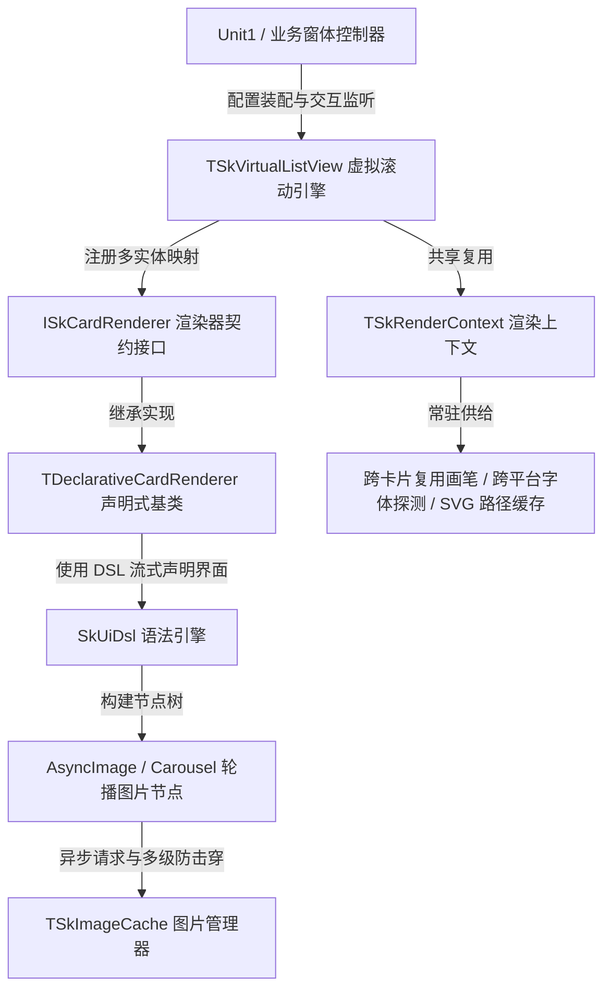
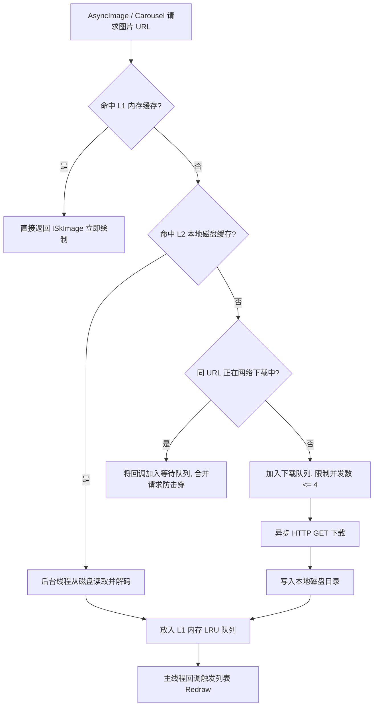
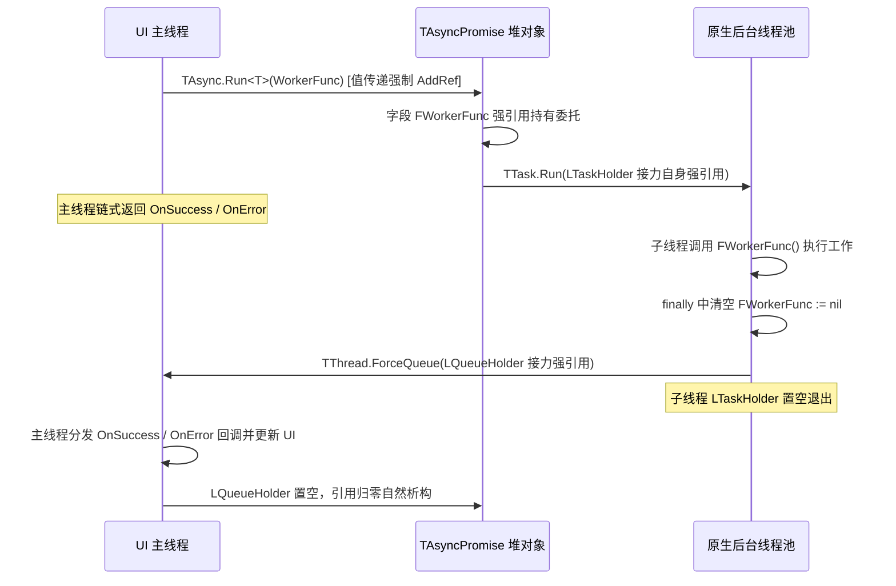
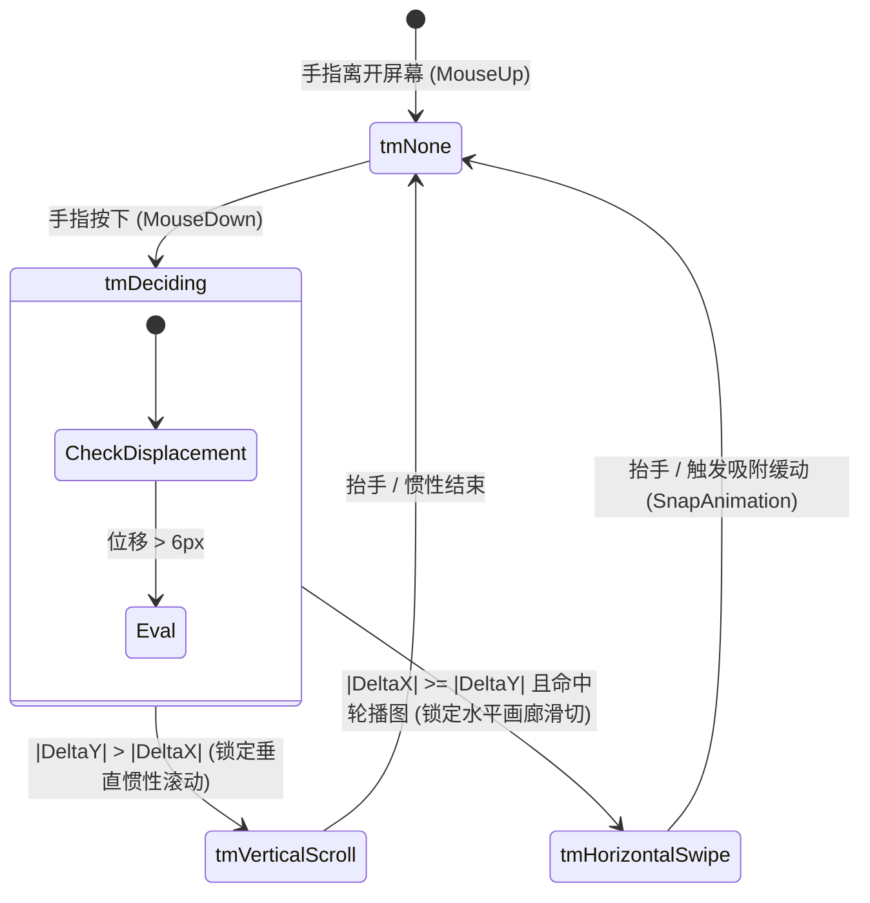
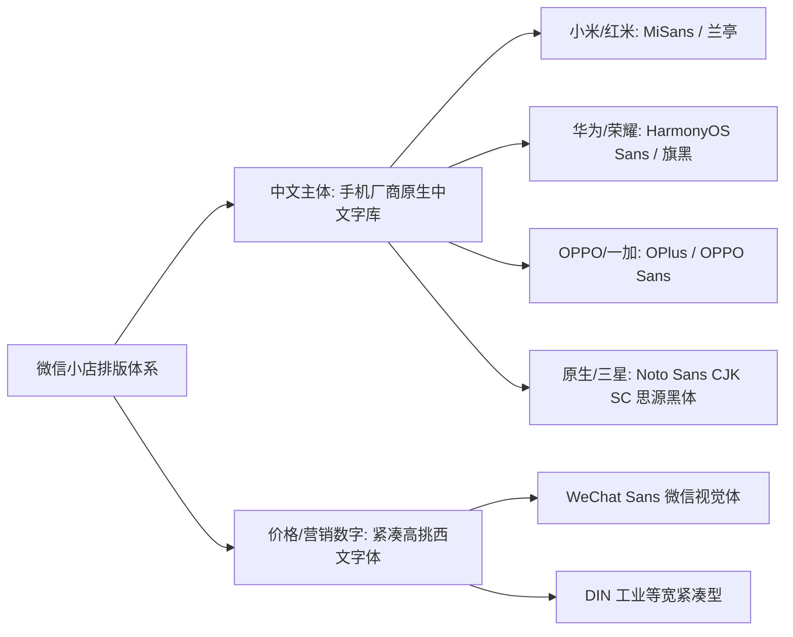

# Delphi FMX + Skia 高性能虚拟化卡片列表与声明式 UI DSL 深度开发手册

## 目录
- [一、 方案概述与技术优势](#一-方案概述与技术优势)
- [二、 架构演进与文件职责清单](#二-架构演进与文件职责清单)
- [三、 快速上手指南 (Quick Start)](#三-快速上手指南-quick-start)
- [四、 核心模块与 API 详解](#四-核心模块与-api-详解)
  - [4.1 通用虚拟滚动引擎：SkVirtualList.Core](#41-通用虚拟滚动引擎skvirtuallistcore)
  - [4.2 声明式 UI DSL 引擎：SkUiDsl](#42-声明式-ui-dsl-引擎skuidsl)
  - [4.3 【核心专题】Flex 弹性伸缩与工业级对齐实战](#43-核心专题flex-弹性伸缩与工业级对齐实战)
  - [4.4 异步多级图片缓存：SkImageCache](#44-异步多级图片缓存skimagecache)
  - [4.5 业务卡片渲染实现：SkCardRenderers.Biz](#45-业务卡片渲染实现skcardrenderersbiz)
  - [4.6 复合单据卡片与业务模型：Biz.OrderModel 与 Biz.OrderRenderer](#46-复合单据卡片与业务模型bizordermodel-与-bizorderrenderer)
  - [4.7 轻量原生异步执行器：SkAsync](#47-轻量原生异步执行器skasync)
- [五、 高阶特性与底层机制深度剖析](#五-高阶特性与底层机制深度剖析)
  - [5.1 单双列同屏异构混排与贪心列高调度 (Heterogeneous Multi-Type Stream)](#51-单双列同屏异构混排与贪心列高调度-heterogeneous-multi-type-stream)
  - [5.2 双轴手势仲裁与平滑画廊巡航 (Touch Arbitration & Carousel)](#52-双轴手势仲裁与平滑画廊巡航-touch-arbitration--carousel)
  - [5.3 动力学消抖、即按即停与原生橡皮筋下拉刷新 (Inertial Stop & Shake-Free Load)](#53-动力学消抖即按即停与原生橡皮筋下拉刷新-inertial-stop--shake-free-load)
  - [5.4 动态高度多行折行自适应与精准物理度量 (Dynamic Height & Wrap)](#54-动态高度多行折行自适应与精准物理度量-dynamic-height--wrap)
  - [5.5 呼吸流光骨架屏与矢量空状态 (Shimmer & Empty State)](#55-呼吸流光骨架屏与矢量空状态-shimmer--empty-state)
  - [5.6 缓动回顶悬浮按钮与微动画交互 (Smooth Back-to-Top)](#56-缓动回顶悬浮按钮与微动画交互-smooth-back-to-top)
  - [5.7 复合单据卡片动态高度度量自适应 (1~N 行商品撑开杜绝重叠)](#57-复合单据卡片动态高度度量自适应-1n-行商品撑开杜绝重叠)
  - [5.8 大卡画廊智能自动巡航与可见性感知 (EnableAutoCruise & AutoCruise)](#58-大卡画廊智能自动巡航与可见性感知-enableautocruise--autocruise)
- [六、 实战教学：如何开发一个全新卡片](#六-实战教学如何开发一个全新卡片)
- [七、 进阶特性与生产环境最佳实践 (Best Practices)](#七-进阶特性与生产环境最佳实践-best-practices)
- [八、 常见问题排查与避坑指南 (FAQ)](#八-常见问题排查与避坑指南-faq)
- [九、 附录：电商主流卡片排版尺寸与字阶设计规范（微信小店标准）](#九-附录电商主流卡片排版尺寸与字阶设计规范微信小店标准)
  - [9.1 字体选型与体系架构 (Font Families)](#91-字体选型与体系架构-font-families)
  - [9.2 微信小店双列卡片骨架与尺寸规范 (Card Dimensions)](#92-微信小店双列卡片骨架与尺寸规范-card-dimensions)
  - [9.3 字阶、字重与配色对照表 (Design Tokens)](#93-字阶字重与配色对照表-design-tokens)
  - [9.4 基于 SkUiDsl 的微信小店卡片落地范例 (DSL Code Reference)](#94-基于-skuidsl-的微信小店卡片落地范例-dsl-code-reference)
- [十、 离线图片占位兜底与数据局部更新 (Partial Refresh)](#十-离线图片占位兜底与数据局部更新-partial-refresh)
  - [10.1 数据局部更新与增量重排 API (Partial Refresh)](#101-数据局部更新与增量重排-api-partial-refresh)
  - [10.2 网络图片三态模型与脉冲/兜底回退 (Shimmer & Fallback)](#102-网络图片三态模型与脉冲兜底回退-shimmer--fallback)
  - [10.3 源码文件编码规范与防乱码指南 (UTF-8 with BOM & Unicode 字面量)](#103-源码文件编码规范与防乱码指南-utf-8-with-bom--unicode-字面量)

---

## 一、 方案概述与技术优势

在传统的 Delphi FireMonkey (FMX) 移动与桌面开发中，展示成百上千条复杂的电商图文卡片时，通常使用 `TVertScrollBox` 结合大量嵌套的子控件（如 `TRectangle`、`TLabel`、`TImage`）。这种传统方案存在三大致命痛点：
1. **排版遍历风暴**：成百上千个子控件在滚动时频繁递归触发 `Align`、`Padding` 和 `Margins` 布局计算，引发严重的 CPU 瓶颈与滑动掉帧；
2. **内存暴涨与 GC 压力**：每个卡片都对应大量 FMX 控件对象与接口实例，导致堆内存剧烈抖动与显存浪费；
3. **异步加载闪烁与幽灵误触**：异步图片下载容易导致主线程卡顿；拖动滑动时手势识别模糊，用户抬手极易引发子项误点击。

**本项目采用现代移动端渲染引擎（Flutter / Jetpack Compose）的思想，基于 Delphi Skia (Sk4D) 构建了完全自绘、高性能、解耦的虚拟化列表与声明式 DSL 解决方案：**

| 评估维度 | 本方案 (SkVirtualCardList) | 传统 FMX (TVertScrollBox + 控件树) |
| :--- | :--- | :--- |
| **渲染核心** | 单一 `TSkPaintBox` 纯 GPU 画布自绘，单层绘制通道 | 繁重的 FMX 树状子控件多层排版与复合渲染 |
| **虚拟化裁剪** | 数学计算可见视口（Windowing），屏幕外 0 绘制 | 全部节点常驻内存与控件树，性能随条目数线性退化 |
| **内存分配** | 跨卡片共享画笔、字体与 SVG 缓存，**单帧零堆内存分配** | 频繁创建/销毁控件与接口实例，GC 与堆内存抖动剧烈 |
| **UI 编写方式** | **声明式 DSL 流式语法**（HStack, VStack, Box, SkText） | 繁琐的 Object Inspector 属性面板或手动计算 Left/Top |
| **弹性布局** | **全功能 Flexbox 弹性伸缩**（权重分配/弹簧推底） | 僵硬的绝对坐标计算，或带来沉重开销的布局容器 |
| **同屏混排** | **单列全宽大图 + 双列网格瀑布流同屏无缝混排** | 极难实现，需手写复杂嵌套容器并承受双重卡顿 |
| **图片轮播** | **单卡片内支持多图手势滑动切换与视口智能巡航** | 需嵌入复杂的分页控件，滑动掉帧严重 |
| **图片缓存** | **L1 内存 LRU + L2 本地磁盘缓存 + 异步并发限流防击穿** | 需自行管理，若主线程处理易导致界面假死 |
| **手势与触控** | 原生 `TAniCalculations` + **双轴手势仲裁，绝无幽灵误触** | 滑动拖拽与子项 Click 容易冲突，误触发严重 |

---

## 二、 架构演进与文件职责清单

系统遵循高内聚、低耦合的分层微内核架构。业务实体、排版布局、底层滚动引擎与多级缓存完全隔离。



### 文件职责清单

| 单元文件 | 架构层级 | 核心职责与设计要点 |
| :--- | :--- | :--- |
| **[SkVirtualList.Core.pas](file:///d:/develop/borland/SkVirtualCardList/SkVirtualList.Core.pas)** | **虚拟滚动微内核** | 包含通用虚拟列表主控控件 `TSkVirtualListView`、共享渲染上下文 `TSkRenderContext`、渲染契约 `ISkCardRenderer`、多实体异构瀑布流贪心调度、`TAniCalculations` 惯性滚动物理引擎、橡皮筋下拉刷新、触底感知加载更多与平滑回顶微动画。 |
| **[SkUiDsl.pas](file:///d:/develop/borland/SkVirtualCardList/SkUiDsl.pas)** | **声明式 UI DSL** | 提供 `HStack`、`VStack`、`Box`、`Spacer`、`SkText`、`AsyncImage`、`Carousel`、`SkSvg`、`SkCircle`、`SkBadge` 等布局与绘制原语。内置双趟 Flexbox 弹性伸缩算法、二分文本折行探测、以及声明式卡片基类 `TDeclarativeCardRenderer`（带测量树缓存 `TCachedLayout`）。 |
| **[SkImageCache.pas](file:///d:/develop/borland/SkVirtualCardList/SkImageCache.pas)** | **多级图片缓存** | 工业级图片流转引擎：L1 内存 LRU 自动淘汰（上限 80）+ L2 磁盘持久化（MD5 缓存文件）+ 异步并发限流（最大 4 并发）+ 请求去重合并（防击穿）+ `Unsubscribe` 生命周期安全注销。 |
| **[SkCardRenderers.Biz.pas](file:///d:/develop/borland/SkVirtualCardList/SkCardRenderers.Biz.pas)** | **业务卡片渲染实现** | 纯净业务实体（`TProductItem`, `TMerchantItem`）与专属渲染器（单列商品卡 `TSingleProductCardRenderer`、双列网格店铺卡 `TDoubleMerchantCardRenderer`）。实现真实物理动态高度度量自适应与手势画廊扩展协议。 |
| **[SkAsync.pas](file:///d:/develop/borland/SkVirtualCardList/SkAsync.pas)** | **轻量流式并发执行器** | 极简 80 行原生异步执行器：基于 `System.Threading.TTask` 弹性线程池，提供流式 `TAsync.Run<T>(Worker).OnSuccess(...).OnError(...)`，自动将结果与异常切回 UI 主线程，零常驻线程句柄与内存泄露。 |
| **[Unit1.pas](file:///d:/develop/borland/SkVirtualCardList/Unit1.pas)** | **业务演示与适配层** | 演示虚拟列表在窗体上的挂载、多类型数据装配、单列/双列/同屏混排模式切换、巡航开关控制、骨架屏与空状态演示、Windows 鼠标滚轮穿透转发与子热区精准响应。 |
| **[SkCardListView.pas](file:///d:/develop/borland/SkVirtualCardList/SkCardListView.pas)** | *历史遗留参考* | *初期单一单体（Monolithic）文件原型，已完成全面架构重构成上述解耦微内核体系，工程中已被上述四个核心单元取代。* |

---

## 三、 快速上手指南 (Quick Start)

### 步骤 1：在窗体中挂载虚拟列表与注册渲染器
```pascal
uses
  System.Types, System.Classes, FMX.Forms, FMX.Types,
  SkVirtualList.Core, SkCardRenderers.Biz;

type
  TMyForm = class(TForm)
  private
    FListView: TSkVirtualListView;
    FRendererProduct: ISkCardRenderer;
    FRendererMerchant: ISkCardRenderer;
    procedure HandleItemClick(Sender: TObject; AIndex: Integer; AItem: TObject; AZoneID: Integer);
    procedure HandleRefresh(Sender: TObject);
    procedure HandleLoadMore(Sender: TObject);
  public
    procedure MouseWheel(Shift: TShiftState; WheelDelta: Integer; var Handled: Boolean); override;
  end;

procedure TMyForm.FormCreate(Sender: TObject);
begin
  // 1. 初始化各业务渲染器
  FRendererProduct := TSingleProductCardRenderer.Create;
  FRendererMerchant := TDoubleMerchantCardRenderer.Create;

  // 2. 创建列表并挂载到界面容器
  FListView := TSkVirtualListView.Create(Self);
  FListView.Parent := LayoutContainer;
  FListView.Align := TAlignLayout.Client;
  FListView.ItemSpacing := 8; // 卡片间距 8px

  // 3. 注册实体映射（支持同屏异构混排）
  FListView.RegisterRenderer(TProductItem, FRendererProduct);
  FListView.RegisterRenderer(TMerchantItem, FRendererMerchant);

  // 4. 绑定点击、下拉刷新与上拉触底事件
  FListView.OnItemClick := HandleItemClick;
  FListView.OnRefresh := HandleRefresh;
  FListView.OnLoadMore := HandleLoadMore;
end;
```

### 步骤 2：加载数据并刷新列表
```pascal
procedure TMyForm.LoadData;
var
  Item: TProductItem;
begin
  FListView.Clear; // 清空旧数据与布局缓存

  Item := TProductItem.Create;
  Item.ID := '101';
  Item.Title := '飞天茅台 53度 500ml';
  Item.Price := 1678.9;
  Item.OriginalPrice := 1099.0;
  Item.Images := [
    'https://example.com/img1.jpg',
    'https://example.com/img2.jpg',
    'https://example.com/img3.jpg'
  ];
  Item.ImageUrl := Item.Images[0];
  Item.TagTop := '官方补贴';
  Item.BottomTag := '假一赔十';
  Item.ShopTag := '小店好货';
  Item.PriceTag := '补贴价';
  Item.AutoCruise := True; // 开启多图自动巡航
  FListView.Items.Add(Item);

  FListView.ScrollToTop;
  FListView.UpdateLayout; // 触发测量与排版布局
end;
```

### 步骤 3：处理桌面端鼠标滚轮穿透（Windows 必备）
Delphi FMX 的 `TPaintBox` / `TSkPaintBox` 默认不拦截操作系统派发的 MouseWheel 消息，需在宿主窗体层重写并向虚拟列表转发：
```pascal
procedure TMyForm.MouseWheel(Shift: TShiftState; WheelDelta: Integer; var Handled: Boolean);
begin
  inherited MouseWheel(Shift, WheelDelta, Handled);
  if not Handled and (FListView <> nil) then
    FListView.MouseWheel(Shift, WheelDelta, Handled);
end;
```

### 步骤 4：生命周期安全注销（防止窗体关闭时报错）
在窗体销毁时调用 `TSkImageCache.Unsubscribe(Self)` 取消排队中的异步下载回调：
```pascal
procedure TMyForm.FormDestroy(Sender: TObject);
begin
  TSkImageCache.Unsubscribe(Self);
end;
```

---

## 四、 核心模块与 API 详解

### 4.1 通用虚拟滚动引擎：`SkVirtualList.Core`

#### 1. `TSkVirtualListView` 核心属性与方法清单

| 属性 / 方法 | 类型 | 核心作用与使用规范 |
| :--- | :--- | :--- |
| **`Items`** | `TObjectList<TObject>` | 数据源容器（`OwnsObjects = True`）。列表全权负责数据对象生命周期管理。 |
| **`RegisterRenderer(Class, Renderer)`** | 过程 | 注册数据类型与渲染器的映射关系，支持单/双列同屏无缝异构混排。 |
| **`Renderer`** | `ISkCardRenderer` | 单一类型模式下的默认回退渲染器。 |
| **`ItemSpacing`** | `Single` | 卡片之间的纵向与横向间隙（默认 8px）。 |
| **`UpdateLayout`** | 过程 | **核心排版驱动**：根据当前容器宽度重新计算所有卡片的绝对插槽（`FSlots`）、瀑布流列高并执行视口裁剪。数据增删改后必须调用。 |
| **`Clear`** | 过程 | 清空所有数据对象、重置轮播动画队列并清空各渲染器的 DSL 排版树缓存。 |
| **`OnItemClick`** | `TOnVirtualItemEvent` | 精准点击回调 `(Sender, Index, Item, ZoneID)`，`ZoneID` 区分整卡或子按钮。 |
| **`EnablePullRefresh`** | `Boolean` | 是否启用顶部橡皮筋下拉刷新（默认 `True`）。 |
| **`OnRefresh` / `FinishRefreshing` / `IsRefreshing`** | 事件 / 过程 / `Boolean` | 下拉超过 50px 松手触发 `OnRefresh`；`IsRefreshing` 为只读状态位；数据加载完成调用 `FinishRefreshing` 平滑复位。 |
| **`OnLoadMore` / `IsLoadingMore`** | 事件 / `Boolean` | 滚动临近底部（提前 1.2 倍视口高度）静默触发 `OnLoadMore`；加载完成置 `IsLoadingMore := False`。 |
| **`PageIndex` / `PageSize`** | `Integer` | 当前页码（初始为 1，下拉刷新自动归位为 1，上拉加载成功自动递增）与每页条数（默认 20）。 |
| **`OnPageFetch`** | `TOnPageFetchEvent` | **【推荐】现代统一分页事件** `(Sender, Page, IsRefresh)`，统一替代并原生兼容原有的 `OnRefresh` 与 `OnLoadMore`。 |
| **`FinishFetch`** | 过程 | **【核心终结方法】**：一行搞定分页生命周期流转。支持 `FinishFetch(Success, HasMore)` 或 `FinishFetch(ItemCount)` 自动推导。 |
| **`HasMore`** | `Boolean` | 是否开启/具有更多数据分页（若设为 `False` 则关闭下一页拉取并触发底部自绘）。 |
| **`NoMoreText` / `ShowNoMoreFooter`** | `string` / `Boolean` | 触底提示文案（默认：“— 已显示全部内容 —”）与原生自绘开关（默认 `True`，无需业务塞假卡片）。 |
| **`IsLoading`** | `Boolean` | 切换骨架屏（Shimmer）模式。置为 `True` 时自动启动微光呼吸正弦动画。 |
| **`EmptyPrompt`** | `string` | 数据为空且非加载态时居中显示的文字提示（默认：“暂无相关数据”）。 |
| **`EnableAutoCruise`** | `Boolean` | 是否允许轮播卡片在静止 3 秒后自动巡航（默认 `True`）。 |
| **`AutoCruiseIntervalMs`** | `Cardinal` | 自动巡航间隔周期（默认 3500ms）。 |
| **`ScrollToTop`** | 过程 | 瞬间滚动回列表最顶端。 |
| **`SmoothScrollToTop`** | 过程 | 260ms 平滑缓动回顶（以 `Cubic-Ease-Out` 三次方曲线驱动）。 |

#### 2. 防误触机制（Anti-Ghost-Click）
用户快速滑动列表手指抬起时，绝不能误触发卡片点击。核心判断逻辑位于触控事件流：
- 记录 `MouseDown` 初始坐标 `FDownPos`；
- 当拖拽位移超过阈值（`CurPos.Distance(FDownPos) > 6px`）时，立即置 `FHasDragged := True` 并取消按下高亮态；
- `MouseUp` 时严格要求 `not FHasDragged`，仅当静止点击时才判定为有效事件，彻底杜绝误触。

#### 3. 共享渲染上下文 `TSkRenderContext`
为避免在每帧 `Draw` 循环中反复创建/销毁 Skia 画笔与字体，`TSkRenderContext` 在初始化时常驻复用核心资源：
- `FillPaint(Color)` / `StrokePaint(Color, Width)`：复用填充与描边画笔；
- `Font(Size, Bold)`：字体对象复用；
- **跨平台中文字体自适应匹配**：内置系统候选字体探测（`Microsoft YaHei`、`PingFang SC`、`Noto Sans CJK SC` 等），跨 Windows/Android/iOS/macOS 均获得无乱码高清渲染；
- `DrawSvgPath(Canvas, SvgPath, DestRect, Color)`：将 SVG Path 解析为 `ISkPath` 并缓存，二次绘制直接使用 GPU 路径。

---

### 4.2 声明式 UI DSL 引擎：`SkUiDsl`

`SkUiDsl` 提供了极其优雅流利的声明式 API，使 Delphi 拥有类似 Flutter / SwiftUI 的编写体验。

#### 1. 容器组件
- **`HStack`（水平排列容器）**：
  - `.Spacing(Single)`：子元素横向间隙；
  - `.Padding(L, T, R, B)` / `.Padding(H, V)` / `.Padding(All)`：外内边距；
  - `.AlignCenter` / `.AlignStart` / `.AlignEnd` / `.AlignStretch`：交叉轴对齐策略；
  - `.Between`：子项两端贴边对齐（`justify-content: space-between`）；
  - `.Children([node1, node2, ...])`：组装子节点数组；
  - `.Flex(Single)`：横向瓜分权重（详见 4.3 节）。
- **`VStack`（垂直排列容器）**：
  - 垂直向下排列子项，支持 `.Spacing`、`.Padding`、`.AlignCenter`、`.AlignStart`、`.AlignEnd`、`.AlignStretch`、`.Flex`。
- **`Box`（样式盒容器）**：
  - `.Fill(Color)`：背景填充色；
  - `.Stroke(Color, Width)`：边框描边；
  - `.Radius(Single)`：全角圆角半径；
  - `.Shadow(Boolean)`：是否开启柔和阴影；
  - `.Padding(...)`：盒模型内边距；
  - `.Size(W, H)` / `.Width(W)` / `.Height(H)`：显式尺寸约束；
  - `.Child(node)` / `.Children([nodes])`：挂载单节点或多节点；
  - `.OnClick(ZoneID)`：定义该盒为独立子热区，点击命中时返回此 `ZoneID`。
- **`Spacer`（弹簧占位符）**：
  - `Spacer.Flex(1)`：自动吞没剩余空间，常用于将操作区或价格栏推至容器尽头；
  - `Spacer(W, H)`：固定空白间隔。

#### 2. 内容组件与高阶属性
- **`SkText(Text)`**：
  - `.Size(Single)` / `.Color(Color)` / `.Bold` / `.Strikethrough`（划线原价）；
  - `.MaxLines(Integer)`：超出最大行数末尾自动绘制省略号（`...`）；
  - `.Wrap(Boolean)`：是否开启多行折行自适应排版。
- **`AsyncImage(Url, Owner)`（异步单图节点）**：
  - `.Size(W, H)` / `.Width(W)` / `.Height(H)`：显式尺寸；
  - `.FillWidth(Boolean)`：横向填满父容器可用宽度；
  - `.Radius(Single)` / `.Radius(TL, TR, BR, BL)`：细粒度圆角；
  - `.RadiusTop(Single)`：快速设置顶部左右圆角（双列封面必备）；
  - `.Placeholder(Color)`：加载未完成时的占位底色；
  - `.Badge(Text, BgColor, RadiusBR, Height)`：快捷角标；
  - `.BadgeRadius(TL, TR, BR, BL)` / `.BadgeFloating(Boolean, Offset)`：悬浮与圆角微调；
  - `.BottomBar(Text, BgColor)`：底部全宽半透明横条；
  - `.OnClick(ZoneID)`：绑定点击热区。
- **`Carousel(Images, Owner)`（多图手势轮播节点）**：
  - `.Size(W, H)` / `.Radius(Single)` / `.FillWidth(Boolean)`；
  - `.ActiveIndex(Integer)`：当前显示第几张大图；
  - `.ScrollOffset(Single)`：手势横滑实时位移；
  - `.AutoCruise(Boolean)`：卡片是否允许自动巡航；
  - `.ShowIndicator(Boolean)`：是否显示底部半透明圆点分页指示器；
  - `.Badge(...)` / `.BottomBar(...)` / `.OnClick(ZoneID)`。
- **`SkSvg(SvgPath)`**：直接绘制 SVG 矢量图标，彻底杜绝跨平台 Emoji 差异。
- **`SkCircle(Radius)`**：自绘几何圆形（支持填充、描边与点击）。
- **`SkBadge(Text)`**：快捷创建彩色背景的文字徽章。

---

### 4.3 【核心专题】Flex 弹性伸缩与工业级对齐实战

`Flex` 是整个声明式 DSL 布局引擎的大脑，源于现代 UI（Flutter `Expanded` / CSS Flexbox）的弹性伸缩哲学。

#### 1. 参数规范与取值范围
- **数据类型**：`Single`（浮点数）；
- **取值范围**：**$\ge 0$ 的非负数**（默认值为 `0`）；
- **核心取值含义**：
  - **`0`（默认值）**：**固定尺寸（非弹性项）**。节点严格按照自身内容（如文本宽度、图片固有大小）计算期望尺寸，不参与瓜分多余空间；
  - **`1`（最常用）**：**独占或均分**。若容器内只有 1 个子项声明了 `Flex(1)`，它将吃掉全部剩余空间；若多个子项同为 `Flex(1)`，则均分剩余空间；
  - **`2, 3, 0.5...`（权重比例）**：按权重数值比例分配容器剩余空间（如 1:2 分割）。

#### 2. 底层排版度量机制（第一性原理数学计算）
在 `THStack.Layout` 与 `TVStack.Layout` 中，引擎通过**严格的两趟加减法**在纯内存中完成单趟布局（耗时 < 0.02ms）：

以包含 1 个左侧固定图片（96px）和 1 个右侧弹性容器（`Flex(1)`）的 `HStack` 为例（总可用宽 360px，间隙 10px）：
1. **第一趟（扣除固定项）**：
   - 累加所有 `Flex = 0` 的固定子项宽度（96px）以及子项间隙（10px）；
   - 计算容器剩余可用空间：
     $$\text{AvailW} = 360\text{px} - 96\text{px} - 10\text{px} = \mathbf{254px}$$
2. **第二趟（分发弹性空间）**：
   - 累加所有弹性项的权重总和：
     $$\text{TotalFlex} = \sum \text{Child.Flex} = 1.0$$
   - 计算单份 Flex 的基准像素：
     $$\text{FlexUnitW} = \frac{\text{AvailW}}{\text{TotalFlex}} = \frac{254}{1.0} = 254\text{px}$$
   - 各弹性子项分得最终宽度：
     $$\text{ChildW} = \text{Child.Flex} \times \text{FlexUnitW} = 1.0 \times 254 = 254\text{px}$$

#### 3. 三大核心实战场景

##### 场景 A：横向占满剩余空间
左侧图片固定为 96px，右侧文字区包裹在 `VStack.Flex(1)` 中。无论卡片在多宽的屏幕上显示，右侧文字区都将自动占满屏幕剩余的所有横向宽度：
```pascal
HStack.Spacing(10).Children([
  ImageNode,                     // 固定宽 96px (Flex = 0)
  VStack.Flex(1).Spacing(4)...   // 自动吃满右侧所有宽度 (Flex = 1)
])
```

##### 场景 B：纵向弹簧推底（底部对齐）
在右侧的 `VStack` 中，放置一个 `Spacer.Flex(1)` 弹簧占位符。它会像压缩弹簧一样，在内存中自动吞噬所有多余的纵向空闲空间，把底部的价格栏和【加入购物车】按钮精准推到卡片最底端：
```pascal
VStack.Flex(1).Spacing(4).Children([
  TitleRow,       // 标题行
  SubtitleText,   // 副标题
  AddressText,    // 地址
  Spacer.Flex(1), // <--- 纵向弹簧！吃掉所有多余高度，把下方推到底部
  BottomPriceRow  // 价格栏与加购按钮
])
```

##### 场景 C：卡片整卡铺满与对齐避坑指南
卡片外框通常带有内边距（如 `Box.Padding(8)`），基准高度为 142px，内部净可用高度为 126px。
- **问题现象**：若外层 `HStack` 未声明 `Flex(1)`，其高度会被算成左侧图片的 114px，导致在 126px 的卡片内部下方空出 12px 悬空缝隙，加购按钮距离卡片底边变成了 $12 + 8 = 20\text{px}$；
- **解决规范**：为根层 `HStack` 显式设置 `.Flex(1)`，并配合 `.AlignStart`：
```pascal
Result := Box.Fill(TAlphaColors.White).Radius(8).Shadow(True).Padding(8).Child(
  HStack.Flex(1).Spacing(10).AlignStart.Children([ // <--- Flex(1) 铺满高度，AlignStart 确保图片顶部对齐
    ImageNode,
    VStack.Flex(1).Spacing(4)...
  ])
);
```
**效果**：无论卡片是普通单行地址（142px），还是超长折行地址（240px），左侧封面图顶边距均严格固定为 8px（与标题平齐），底部加购按钮底边距均严格固定为 8px，实现像素级工业对齐。

---

### 4.4 异步多级图片缓存：`SkImageCache`

`TSkImageCache` 实现了工业级的安全三级图片流转模型：



- **L1 内存 LRU**：内存驻留最多 80 张解码纹理，超出时淘汰最久未使用项，借助 Delphi ARC 释放显存；
- **L2 磁盘持久化**：以 URL 的 MD5 为文件名存入 `SkiaImgCache/`，二次启动零网络流量瞬间秒开；
- **请求去重合并与限流**：并发下载最大限制为 4，相同图片合并为一个网络请求，防止列表狂甩击穿系统网络栈；
- **生命周期安全（`Unsubscribe`）**：窗体关闭时调用 `TSkImageCache.Unsubscribe(Self)` 废弃等待中的回调，杜绝 AV 报错。

---

### 4.5 业务卡片渲染实现：`SkCardRenderers.Biz`

该单元包含具体卡片范例：
1. **单列全宽商品卡（`TSingleProductCardRenderer`）**：
   - 通栏大卡（`SpanCount = 1`），包含多图轮播封面、标签、日期、路段 SVG 图标、自适应折行地址、弹簧推底价格与加购热区；
2. **双列网格店铺卡（`TDoubleMerchantCardRenderer`）**：
   - 双列瀑布流卡（`SpanCount = 2`），顶部 4:3 封面图（`Height(115).RadiusTop(8).FillWidth(True)`），底部展示金牌店铺标签、地址、销量与五角星评分，评分 $\ge 4.7$ 自动拓高展示专属服务横幅（高度由 202 拓高至 226）。

---

### 4.6 复合单据卡片与业务模型：`Biz.OrderModel` 与 `Biz.OrderRenderer`

针对《我的订单》等典型“按单据分组（组头、商品明细、组尾）”场景，系统提供工业级的**方案 A 复合单据卡片**实现范式：

#### 1. 数据模型设计 (`Biz.OrderModel.pas`)
`pascal
type
  // 单个商品明细项
  TOrderItemDetail = class
  public
    ProductName: string;
    ImageUrl: string;
    SpecName: string;
    Price: Currency;
    Quantity: Integer;
    constructor Create(const AName, AImg, ASpec: string; const APrice: Currency; const AQty: Integer);
  end;

  // 完整订单模型 (列表中的一个独立 Item)
  TOrder = class
  public
    OrderId: string;
    OrderDate: string;
    StatusText: string;
    Details: TObjectList<TOrderItemDetail>;
    TotalQty: Integer;
    TotalAmount: Currency;
    constructor Create(const AId, ADate, AStatus: string); overload;
    procedure AddDetail(const AName, AImg, ASpec: string; const APrice: Currency; const AQty: Integer);
  end;
`

#### 2. 声明式复合卡片渲染器 (`Biz.OrderRenderer.pas`)
一张订单表现为一张具有统一白底、圆角与立体投影的完整卡片，无论订单下挂载 1 个还是多个商品，内部均由 DSL 流式组织，且严格自适应高度：
`pascal
const
  ZONE_BTN_CANCEL     = 101; // 取消订单热区
  ZONE_BTN_LOGISTICS  = 102; // 查看物流热区
  ZONE_BTN_PAY        = 103; // 立即支付热区

type
  TOrderCardRenderer = class(TDeclarativeCardRenderer)
  public
    constructor Create;
    function GetItemHeight(AContext: TSkRenderContext; AColWidth: Single; AItem: TObject = nil): Single; override;
    function BuildLayout(AItem: TObject): IUiNode; override;
  end;
`
- **组头区域**：左侧展示单号与下单时间，右侧展示醒目的订单状态（如“待付款”、“配送中”）；
- **中部明细**：`for` 循环动态生成 1~N 行商品条目（商品缩略图 56x56、商品名称、规格、单价与购买件数）；
- **组尾汇总与动作条**：左侧合计件数与实付金额，右侧并列放置“查看物流”与“去支付”按钮（通过 `SkBadge(...).OnClick(ZONE_ID)` 绑定专属子热区）；
- **动态高度自适应度量**：重写 `GetItemHeight`，调用当前列宽下的 `BuildLayout(AItem).Measure(AContext, AColWidth, 10000)` 获取整张卡片的真实物理高度，彻底杜绝下一张卡片遮挡覆盖（详见 5.7 节）。

---

### 4.7 轻量原生异步执行器：`SkAsync`

针对网络请求、数据库查询及重度 I/O 等异步操作，项目完全抛弃庞大臃肿且存在内存管理隐患的第三方 Promise 库，基于 Delphi 原生 `System.Threading.TTask` 与 `TThreadPool` 设计了零依赖、轻量级的流式异步执行器 [`SkAsync.pas`](file:///d:/develop/borland/SkVirtualCardList/SkAsync.pas)。

#### 1. 核心设计原则（KISS 原则与第一性原理）
1. **零外部依赖**：100% 基于 RTL 官方原生线程池与任务调度系统；
2. **弹性伸缩**：按 CPU 核心按需弹性调配后台工作线程，杜绝空转开销与常驻线程句柄泄漏；
3. **主线程安全投递**：无论后台子线程何时完成，`.OnSuccess` 与 `.OnError` 回调均通过 `TThread.ForceQueue` 自动投递到 Windows / FMX 消息循环，确保 UI 安全更新；
4. **异常穿透与故障容错**：子线程内未捕获的任何异常（如 HTTP 超时、网络断开）均通过 `AcquireExceptionObject` 封包，穿透至 `.OnError` 回调集中处置，绝不会引发应用崩溃。

#### 2. 生命周期闭环接力模型（彻底根除 Delphi 匿名函数 AV 陷阱）
在 Delphi 中，内联匿名方法 `function: T begin ... end` 本质为编译器生成的隐式临时接口实例。若直接链式调用且未被持有，该临时接口将在主线程语句结束时提前被 Free，导致子线程读取已释放内存触发 Access Violation（$C0000005）。`SkAsync` 采用创新的三层闭环接力机制解决此顽疾：



#### 3. 典型调用范例（与 OnPageFetch 分页完美融合）
```pascal
TAsync.Run<TArray<TObject>>(
  function: TArray<TObject>
  var
    Items: TList<TObject>;
  begin
    // 1. 【子线程执行】模拟耗时网络 I/O 延迟
    Sleep(350);
    if FSimulateError then
      raise Exception.Create('远程接口请求超时 [HTTP 504]');

    Items := TList<TObject>.Create;
    try
      // 读取网络 JSON 并构造业务实体对象...
      Result := Items.ToArray;
    finally
      Items.Free;
    end;
  end)
  .OnSuccess(procedure(AItems: TArray<TObject>)
  var
    Item: TObject;
  begin
    // 2. 【UI 主线程安全回调】渲染到虚拟列表并收敛分页状态
    if AIsRefresh then
      FListView.Clear;
    for Item in AItems do
      FListView.Items.Add(Item);
    FListView.FinishFetch(True, APage < 5);
  end)
  .OnError(procedure(E: Exception)
  begin
    // 3. 【UI 主线程安全回调】捕获异常、弹窗提示
    FListView.FinishFetch(False, False);
    TDialogService.ShowMessage('接口拉取失败: ' + E.Message);
  end);
```

---

## 五、 高阶特性与底层机制深度剖析

### 5.1 单双列同屏异构混排与贪心列高调度 (Heterogeneous Multi-Type Stream)

支持在同一个虚拟列表中同屏混排不同列数、不同高度的数据流（如第 1~4 项为单列全宽大图商品，第 5~10 项为双列店铺网格）：

```pascal
// 注册多实体对应关系
FListView.RegisterRenderer(TProductItem, FRendererProduct);   // SpanCount = 1
FListView.RegisterRenderer(TMerchantItem, FRendererMerchant); // SpanCount = 2
```

#### 瀑布流列高贪心调度算法
在 `TSkVirtualListView.UpdateLayout` 中：
- 维护双列底线数组 `ColBottomY[0]` 与 `ColBottomY[1]`；
- **遇单列项（SpanCount = 1）**：自动拉平两列当前最大 Y 值（`Max(ColBottomY[0], ColBottomY[1])`），全宽放置，并统一向下推进；
- **遇双列项（SpanCount = 2）**：执行贪心算法，自动将卡片填充进当前累计高度较短的一列，两列独立生长。

---

### 5.2 双轴手势仲裁与平滑画廊巡航 (Touch Arbitration & Carousel)

为了彻底解决列表纵向滚动与卡片内部多图横向滑切的手势冲突，列表引入了精密的**触摸状态机（Touch Arbitration State Machine）**：



1. **手势吸附判定**：
   - 当水平拖拽幅度超过图片宽度的 20% 时，判定为成功翻页（向左切下一张，向右切上一张，支持末张循环切回第 1 张）；
   - 幅度不足 20% 则回弹归零；
2. **20ms 定时器驱动 Cubic-Ease-Out**：
   - 动画不在主线程阻塞执行，而是由 `FCruiseTimer`（20ms）逐帧推进 `TSnapAnimation`，以 $1.0 - (1.0 - t)^3$ 曲线平滑过渡，视觉吸附极其丝滑；
3. **智能防打扰巡航**：
   - 用户操作期间立即挂起，停止操作静止满 3 秒后，每隔 3.5 秒自动为视口内声明了 `AutoCruise = True` 的大图卡片触发下一张巡航。

---

### 5.3 动力学消抖、即按即停与原生橡皮筋下拉刷新 (Inertial Stop & Shake-Free Load)

#### 1. 手势触控即按即停（动力学刹车机制）
- **现象痛点**：用户快速甩动列表产生高速惯性滑行时，底层 `TAniCalculations` 定时器以几十像素每帧递减积分。若手指再次接触屏幕而没有终止动力学，列表在接触瞬间仍会发生微量位移或延迟停顿，手感粘滞不干脆；
- **核心修复**：在 `TSkVirtualListView.MouseDown` 的第一时刻触发动力学刹车：
  ```pascal
  // 即按即停：通过关闭并重置 Animation 立即终止内部动力学定时器并将速度清零
  if FAniCalculations <> nil then
  begin
    FAniCalculations.Animation := False;
    FAniCalculations.Animation := True;
  end;
  FIsScrollingToTop := False;
  FActiveSnaps.Clear;
  ```
  该逻辑立即锁定当前视口坐标，停止惯性滑行并清空吸附队列，手指接触即刻静止，随按随停。

#### 2. 提前 1.2 屏静默拉取与消灭分页晃动抖动
- **现象痛点**：旧逻辑触底阈值仅 80px，快速滑行时视口瞬息进入底层 **OverScroll 越界回弹物理区**（橡皮筋阻尼拉伸），物理引擎向上回弹与分页数据向下拔长来回撕扯，加之旧代码在加载中动态追加 38px 临时高度，引发强烈的上下抽搐晃动；
- **核心修复**：
  1. 将加载阈值扩展至提前预留 1.2 倍视口高度进行**静默预拉取**：
     ```pascal
     if (TotalH > Height) and ((FScrollY + Height) >= (TotalH - (Height * 1.2))) then
     begin
       FIsLoadingMore := True;
       FOnLoadMore(Self);
     end;
     ```
  2. 拉取期间不进行冗余重排与重绘，绝不触碰底部的越界回弹物理区，滑动保持匀速顺滑；
  3. 坚决移除 `FTotalContentHeight` 动态累加 38px 的代码，保持总高度单调递增，彻底根除分页抖动。

#### 3. 原生橡皮筋下拉刷新与业务模式保持
- **下拉阻尼与三段式状态提示**：
  - 下拉距离 < 50px：提示“下拉即可刷新...”；
  - 下拉距离 >= 50px：提示“释放立即刷新”；
  - 松手释放：弹性定格在 -60px 并提示“正在刷新数据...”，同时触发 `OnRefresh` 回调；
- **业务模式保持规范**：在业务窗体的 `HandleRefresh` 事件中，必须严格根据当前模式（`FCurrentMode`）分发重载方法（如单列商品、双列店铺、同屏混排或订单分组），刷新完毕调用 `FListView.FinishRefreshing` 平滑复位，杜绝刷新后视图被错误重载为其他模式。

#### 4. 极简统一分页控制器与触底自绘闭环 (OnPageFetch & FinishFetch)

为避免业务窗体自行定义 `PageIndex`、在各处手动累加/重置并调用繁琐的状态收敛过程，列表微内核内置了工业级通用分页控制器：

- **统一回调 `OnPageFetch(Sender, Page, IsRefresh)`**：
  - 下拉刷新时：内部自动将页码锁定为 `1` 并触发 `IsRefresh = True`；
  - 临近触底时：内部自动预测拉取下一页（`TargetPage := PageIndex + 1`）并触发 `IsRefresh = False`；
- **一行代码终结状态流转（`FinishFetch`）与异步执行器 `TAsync`**：
  结合工程内置的轻量异步执行器 [`SkAsync.pas`](file:///d:/develop/borland/SkVirtualCardList/SkAsync.pas)，在子线程中调用耗时网络接口，并在主线程安全接收数据与拦截异常：
  ```pascal
  procedure TForm1.HandlePageFetch(Sender: TObject; const APage: Integer; const AIsRefresh: Boolean);
  begin
    // 使用 TAsync.Run 派发后台线程池执行接口拉取
    TAsync.Run<TArray<TObject>>(
      function: TArray<TObject>
      begin
        // 1. 【子线程执行】网络 I/O 或接口请求；若断网或接口异常直接 raise
        Result := ApiFetchPageItems(APage);
      end)
      .OnSuccess(procedure(AItems: TArray<TObject>)
      begin
        // 2. 【UI 主线程安全回调】成功渲染数据到列表
        if AIsRefresh then FListView.Clear;
        for var Item in AItems do
          FListView.Items.Add(Item);

        // 核心终结：一行完成页码递增、解除防重入锁、收起刷新条，并根据条目数自动判定 HasMore
        FListView.FinishFetch(Length(AItems));
      end)
      .OnError(procedure(E: Exception)
      begin
        // 3. 【UI 主线程安全回调】拦截异常、弹窗提示并收敛分页状态
        FListView.FinishFetch(False, False); // 平滑复位并解除防重入锁
        TDialogService.ShowMessage('接口拉取失败: ' + E.Message);
      end);
  end;
  ```
- **触底“已显示全部内容”原生自绘（Zero-Card Footer）**：
  - 当 `HasMore = False` 时，`GetTotalContentHeight` 自动向下延展 42px 物理安全间距；
  - 底层 Canvas 在进入视口时，以浅灰色字体与精巧的左右微细线自绘 `— 已显示全部内容 —`（文案支持由 `NoMoreText` 自定义）；
  - 彻底免去传统方案中强行往业务实体列表里追加一个 `TFooterItem` 假卡片的侵入性丑陋写法。

---

### 5.4 动态高度多行折行自适应与精准物理度量 (Dynamic Height & Wrap)

面对电商多变的超长地址，卡片支持单行截断与多行自适应折行：

1. **二分折行探测算法**：
   在 [`SkUiDsl.pas`](file:///d:/develop/borland/SkVirtualCardList/SkUiDsl.pas) 中提供 `SplitTextLines` 函数，利用 `ISkFont.MeasureText` 与二分查找对文字进行断行计算；
2. **真实物理度量（DSL Measure）紧凑撑开**：
   在 `TSingleProductCardRenderer.GetItemHeight` 中直接利用当前平台的真实字体指标调用 DSL 布局树的 `Node.Measure(AContext, AColWidth, 10000)`，得出当前设备下的绝对真实物理高度，并附加 8px 呼吸安全余量（`Max(142, Desired.cy + 8)`），彻底杜绝人工手算误差，确保跨 Windows/Android 平台下【加入购物车】按钮绝不溢出底边；
3. **DSL 声明自适应**：
   在卡片声明中只需为文本添加 `.Wrap(P.MultiLineAddress)`，文字即在可用宽度内自动换行，内部的 `Spacer.Flex(1)` 弹簧自动配合将操作区推至相应底部。

---

### 5.5 呼吸流光骨架屏与矢量空状态 (Shimmer & Empty State)

#### 1. 呼吸微光骨架屏（Shimmer）
当列表设置 `FListView.IsLoading := True` 时，自动进入骨架屏模式：
- 保持卡片阴影白底框架；
- 内部图片块、标题条、副标题条、价格条均呈现正弦波动平滑呼吸动画（亮度在 230 ~ 246 之间正弦振荡）：
  ```pascal
  GrayVal := EnsureRange(Round(236 + 10 * Sin(FShimmerPhase * Pi + R * 0.4)), 0, 255);
  ```
- 双列模式下自动呈现双列店铺专属骨架屏，避免网络慢时界面空白。

#### 2. 矢量自绘空状态
当 `Items.Count = 0` 且未处于加载中时，列表自动居中自绘灰色几何开箱矢量图与 `EmptyPrompt` 提示文案，排版优雅。

---

### 5.6 缓动回顶悬浮按钮与微动画交互 (Smooth Back-to-Top)

- **渐变呈现**：当列表滚动距离 `FScrollY > 180px` 时，右下角自动浮现圆形悬浮按钮（自绘圆形投影底座 + 向上箭头图标）；
- **最高点击优先级**：在 `MouseDown` 第一阶段优先拦截悬浮按钮区域，无需等待手势判定；
- **260ms 平滑回滚**：点击后触发 `SmoothScrollToTop`，以 `Cubic-Ease-Out` 曲线平滑回滚至列表顶端，回滚期间悬浮按钮立即隐藏，绝不残留。

---

### 5.7 复合单据卡片动态高度度量自适应 (1~N 行商品撑开杜绝重叠)

在《我的订单》等复合业务场景中，一张订单可能包含 1 个、2 个甚至更多商品明细，整张卡片的物理高度是动态不确定的。

#### 1. 致命避坑：为何不能使用基类固定高度？
- 基类 `TDeclarativeCardRenderer.GetItemHeight` 默认返回 `FItemHeight`（例如 200px）；
- 若订单包含 2 件商品，卡片内部实际排版高度达到 230px，而列表分配给该插槽的高度只有 200px；
- 导致下一张订单卡片直接从 Y=208px 开始排，硬生生盖在上一张卡片底部的“查看物流/去支付”按钮区域上，造成严重的视觉遮挡与按钮穿透。

#### 2. 标准解法：在渲染器中重写 `GetItemHeight` 并调用 DSL Measure
```pascal
function TOrderCardRenderer.GetItemHeight(AContext: TSkRenderContext; AColWidth: Single; AItem: TObject = nil): Single;
var
  Order: TOrder;
  LayoutCache: TCachedLayout;
  Desired: TSizeF;
begin
  Result := FItemHeight;
  if (AItem <> nil) and (AItem is TOrder) then
  begin
    Order := TOrder(AItem);
    // 1. 获取或构建当前列宽下的 DSL 节点树
    if not FCache.TryGetValue(AItem, LayoutCache) or (LayoutCache.Node = nil) or
       (Abs(LayoutCache.Width - AColWidth) > 0.5) then
    begin
      LayoutCache.Node := BuildLayout(AItem);
      LayoutCache.Width := AColWidth;
      LayoutCache.Height := 0;
      FCache.AddOrSetValue(AItem, LayoutCache);
    end;

    // 2. 利用真实设备字体指标与节点层级精准度量出真实高度 (含 N 行明细与上下 Padding)
    if (LayoutCache.Node <> nil) and (AContext <> nil) then
    begin
      Desired := LayoutCache.Node.Measure(AContext, AColWidth, 10000);
      Result := Max(140, Desired.cy);
    end
    else
      Result := 34 + (Order.Details.Count * 68) + 44 + 24; // 兜底估算
  end;
end;
```
**技术收益**：每个单据卡片插槽根据商品行数 100% 严丝合缝撑开，卡片之间保持预设的 `ItemSpacing` 间隙，彻底消除卡片之间的遮挡与重叠。

---

### 5.8 大卡画廊智能自动巡航与可见性感知 (EnableAutoCruise & AutoCruise)

为了在电商首页通栏爆款大卡上呈现生动的画廊轮播效果，虚拟滚动引擎提供了列表级全局控制与实体级独立配置兼备的**平滑自动巡航机制**。

#### 1. 双层开关控制体系
- **列表级总控开关 (`TSkVirtualListView.EnableAutoCruise`)**：
  提供业务界面全局开关。置为 `True` 时开启巡航守护；置为 `False` 时立即注销并停止底层 20ms 高精度驱动时钟，CPU 绝对 0 开销：
  ```pascal
  // 切换自动巡航总开关
  FListView.EnableAutoCruise := not FListView.EnableAutoCruise;
  ```
- **实体级独立配置 (`AutoCruise: Boolean`)**：
  同屏混排时，并非所有卡片都需要轮播。通过在具体的业务实体上声明 `AutoCruise` 字段，可精确控制仅特定的重点爆款卡片执行轮播，普通卡片静止：
  ```pascal
  // 仅首个爆款通栏大卡开启智能巡航，其余卡片保持静态
  ProdItem.AutoCruise := (Index = 0);
  ```

#### 2. 视口可见性感知与手势防冲突机制
1. **视口可见性判定**：轮播触发时首先探测卡片的物理视口包围盒。若卡片已滚出屏幕之外（不可见），自动跳过本次轮播，彻底杜绝屏幕外的无效计算与 GPU 纹理调度；
2. **手势冲突仲裁**：当用户手指接触屏幕进行上下滚动或水平滑切时，自动巡航立即挂起；用户抬手且列表静止满 3 秒后，自动恢复下一次轮播；
3. **丝滑 Cubic-Ease-Out 吸附缓动**：每次切换不突变跳帧，而是由 `TSnapAnimation` 在 280ms 内沿三次平滑减速曲线吸附至下一张图片，并同步更新小圆点指示器。

---

## 六、 实战教学：如何开发一个全新卡片

以新增一个**“用户动态评论卡片”**为例：

### 步骤 1：定义实体与子热区常量
```pascal
type
  TCommentItem = class
  public
    AvatarUrl: string;
    UserName: string;
    PostTime: string;
    Content: string;
    LikeCount: Integer;
  end;

const
  ZONE_LIKE_BTN = 101; // 点赞按钮热区 ID
```

### 步骤 2：继承 `TDeclarativeCardRenderer` 编写 DSL 布局
```pascal
type
  TCommentCardRenderer = class(TDeclarativeCardRenderer)
  public
    constructor Create;
    function BuildLayout(AItem: TObject): IUiNode; override;
  end;

constructor TCommentCardRenderer.Create;
begin
  inherited Create(1, 100); // 1 列通栏，基准高度 100px
end;

function TCommentCardRenderer.BuildLayout(AItem: TObject): IUiNode;
var
  C: TCommentItem;
begin
  C := TCommentItem(AItem);

  Result := Box.Fill(TAlphaColors.White).Radius(8).Shadow(True).Padding(12).Child(
    HStack.Flex(1).Spacing(10).AlignCenter.Children([
      // 1. 用户头像（圆形剪裁，44x44）
      AsyncImage(C.AvatarUrl).Size(44, 44).Radius(22),

      // 2. 文本内容区（弹性撑满中间区域）
      VStack.Flex(1).Spacing(4).Children([
        HStack.Between.Children([
          SkText(C.UserName).Bold.Size(13).Color($FF333333),
          SkText(C.PostTime).Size(11).Color($FF999999)
        ]),
        SkText(C.Content).Size(12).Color($FF555555).MaxLines(2)
      ]),

      // 3. 点赞按钮区（独立热区绑定）
      Box.Padding(6, 4).OnClick(ZONE_LIKE_BTN).Child(
        HStack.Spacing(4).AlignCenter.Children([
          SkSvg(SVG_STAR).Size(14, 14).Color($FFFF9800),
          SkText(C.LikeCount.ToString).Size(11).Color($FFFF9800)
        ])
      )
    ])
  );
end;
```

---

## 七、 进阶特性与生产环境最佳实践 (Best Practices)

### 1. 业务数据实体保持无状态（Stateless）
- 严禁在 `TProductItem` 等数据实体中存放 `LastCardRect` 等 UI 绘制坐标或控件实例；
- 测量结果完全由渲染器内部的 `TCachedLayout` 托管，使得同一份业务数据可以随时无缝切换到任意不同形态的渲染器。

### 2. 局部刷新与排版缓存清空
- `TDeclarativeCardRenderer` 会缓存每个 `AItem` 对应的 DSL 测量树。若数据被修改：
  ```pascal
  // 数据更新时清空排版缓存并触发重绘
  (FListView.Renderer as TDeclarativeCardRenderer).ClearCache;
  FListView.Redraw;
  ```

### 3. Delphi 源码编码规范（严禁乱码）
- 所有包含中文字符串、SVG 常量的 `.pas` 源码文件，**必须强制以 UTF-8 with BOM 格式保存**，确保跨平台编译器（DCC32/DCC64/DCCAARM）编译中文常量不乱码。

### 4. 容器组件裁剪（ClipChildren）
- 挂载 `TSkVirtualListView` 的父容器 `TLayout`，建议务必开启 `LayoutContainer.ClipChildren := True;`，防止下拉或回弹时卡片溢出绘制到上方导航栏。

---

## 八、 常见问题排查与避坑指南 (FAQ)

### Q1：在 Windows 下滚动鼠标滚轮，列表没有任何反应？
**解答**：FMX 下非焦点的 `TPaintBox` / `TSkPaintBox` 不会自动接收 Windows 的滚轮消息。必须在宿主窗体的 `MouseWheel` 虚方法中转发给列表（参考 3.3 节）。

### Q2：快速猛烈滑动列表时，手势松开瞬间会不会触发误点击？
**解答**：不会。引擎内部利用 `TAniCalculations` 精确追踪手指位移。只要拖拽位移大于 6px，就会标记 `FHasDragged := True`。在 `MouseUp` 中会自动拦截并丢弃一切点击事件，彻底根除“幽灵误触”。

### Q3：为什么长卡片加高后，图片会垂直居中留下大片空白？
**解答**：因为最外层 `HStack` 默认为垂直居中（`alCenter`）。只需在最外层 `HStack` 加上 `.AlignStart`，左侧封面图就会始终紧贴卡片顶部内边距（固定 8px），与第一行标题对齐。

### Q4：为什么普通短卡片的加购按钮底部留白比长卡片大？
**解答**：因为外层 `HStack` 默认未声明 `Flex(1)`，其高度被算成图片的高度（114px），未填满卡片净可用空间（126px）。只需为外层 `HStack` 添加 `.Flex(1)`，右侧的 `Spacer.Flex(1)` 弹簧即可把加购按钮沉底贴紧卡片内边距底边（固定 8px）。

### Q5：如何注销生命周期防止窗体关闭时报错？
**解答**：在窗体的 `FormDestroy` 事件中调用 `TSkImageCache.Unsubscribe(Self)`，即可取消所有关联到该窗体的未完成下载回调。

### Q6：为什么单据卡片包含多个商品时，下一张卡片会把当前卡片底部的按钮盖住？
**解答**：因为渲染器没有重写 `GetItemHeight`，回退到了基类声明的固定高度（如 200px）。而多个商品的卡片实际高度大于 200px，虚拟列表为下一张卡片计算的起始 Y 坐标偏小，导致下一张卡片叠在上一张卡片底部。**必须在渲染器中重写 `GetItemHeight`，调用 `BuildLayout(AItem).Measure` 度量出真实动态高度**（详见 5.7 节）。

### Q7：为什么在订单列表等非默认模式下下拉刷新，列表数据变回了商品/混排模式？
**解答**：这是由于窗体中绑定的 `HandleRefresh` 事件内漏掉了对当前模式的判断分支，直接落入了最后的 `else LoadMixedData`。应在 `HandleRefresh` 中根据 `FCurrentMode = vmOrder` 明确调用 `LoadOrderData`，并在异步加载完成后调用 `FListView.FinishRefreshing`。

---

## 九、 附录：电商主流卡片排版尺寸与字阶设计规范（微信小店标准）

本节收录微信小店（小程序/网页流）在移动端交易卡片中的经典排版比例、字阶体系与配色规范，供后续业务卡片 UI 设计与 Skia DSL 复刻时作为工业级基准参考。

---

### 9.1 字体选型与体系架构 (Font Families)

微信在移动端呈现出极高的高清质感与阅读亲和力，其本质依托于“**厂商原生黑体 + 专属定制价格数字**”的双轨体系：



1. **中文正文**：直接调用系统原厂黑体（不内置庞大字库），字腔开阔、内白均匀、单字视觉平衡极佳；
2. **价格与金额数字**：采用 **WeChat Sans** 或 **DIN** 风格西文字体，数字比例窄长挺拔、结构硬朗，在紧凑的双列网格中大幅增强金额的视觉穿透力与转化率。

---

### 9.2 微信小店双列卡片骨架与尺寸规范 (Card Dimensions)

```text
┌──────────────────────────────────────────────┐
│  1. 封面图 (1:1 正方形 或 4:3 横图)            │
│     - 满宽填充: FillWidth(True)                │
│     - 顶部圆角: RadiusTop(8)                   │
├──────────────────────────────────────────────┤
│  2. 卡片信息主体 (Padding: 8px ~ 10px)         │
│     ┌──────────────────────────────────────┐ │
│     │ [品牌] 【热销好物】五常大米 5kg...     │ │ (MaxLines: 2, LineHeight: 1.25)
│     ├──────────────────────────────────────┤ │
│     │ 11.11  214人赞过  ·  运费险          │ │ (营销/社交背书标签行)
│     ├──────────────────────────────────────┤ │
│     │ ¥ 9.9 新客价            已售 1586    │ │ (推底紧凑价格行 + 辅助销量)
│     └──────────────────────────────────────┘ │
└──────────────────────────────────────────────┘
```

- **卡片基座**：纯白底色（`$FFFFFFFF`）、圆角 `Radius(8)`，微阴影（`Shadow(True)`）或细边框（`Stroke($FFF2F2F2, 0.5)`）；
- **图片比例**：通常为 1:1 正方形（如 172x172px），或 4:3 比例（如 172x129px）；
- **信息区内边距**：横向 `8px ~ 10px`，纵向 `8px ~ 10px`；各行间距 `Spacing: 4px ~ 6px`。

---

### 9.3 字阶、字重与全局设计常量子系统 (Typography Tokens)

为了便于项目在不同屏幕密度或企业品牌风格下统一全局微调字阶，`SkUiDsl.pas` 将这套字阶体系沉淀为标准常量与语义化 DSL 扩展：

```pascal
const
  FONT_SIZE_HERO_PRICE   = 18.0; // 超大促销价格 (如微信小店核心金额)
  FONT_SIZE_PRICE        = 15.0; // 标准卡片主价格
  FONT_SIZE_TITLE_LG     = 14.5; // 一级突出标题
  FONT_SIZE_TITLE        = 13.5; // 标准商品/单据卡片标题 (最多 2 行)
  FONT_SIZE_BODY         = 12.0; // 标准正文 / 单号 / 规格参数
  FONT_SIZE_SUB          = 11.0; // 副标题 / 下单时间 / 营销标签
  FONT_SIZE_CAPTION      = 10.0; // 辅助说明 / 销量 / 货币符号 '¥'
  FONT_SIZE_BADGE        = 9.5;  // 微型胶囊标签 / 极小徽章
  FONT_SIZE_TINY         = 8.5;  // 极小标签 / 紧凑横幅
```

同时 `TTextNode` 支持便捷的语义化链式调用：
- `SkText('标题').AsTitle`（等价于 `.Size(FONT_SIZE_TITLE)`）
- `SkText('¥99.0').AsPrice`（等价于 `.Size(FONT_SIZE_PRICE).Bold`）
- `SkText('正文').AsBody`（等价于 `.Size(FONT_SIZE_BODY)`）
- `SkText('副标题').AsSub`（等价于 `.Size(FONT_SIZE_SUB)`）
- `SkText('辅助说明').AsCaption`（等价于 `.Size(FONT_SIZE_CAPTION)`）
- `SkText('微标').AsBadge`（等价于 `.Size(FONT_SIZE_BADGE)`）

#### 微信小店实测区块与 Token 对照表

| UI 视觉区块 | 推荐字号 (Size) | 对应 DSL Token | 推荐颜色 (ARGB Hex) | 说明与排版细节 |
| :--- | :--- | :--- | :--- | :--- |
| **品牌前缀标签** | **9.5 px** | `FONT_SIZE_BADGE` | `$FFB8741A`（金棕色） | 紧贴商品标题左侧，可加浅金底色小胶囊徽章。 |
| **商品标题** | **13.5 px** | `FONT_SIZE_TITLE` | `$FF1A1A1A`（深黑灰） | 最多展示 2 行（超出截断），避免过黑产生视觉压迫感。 |
| **营销 / 促销标签** | **11.0 px** | `FONT_SIZE_SUB` | `$FFE6432E`（醒目红橙） | 如 “11.11”、“热卖爆款”、“官方补贴”。 |
| **评价 / 社交标签** | **10.0 px ~ 11 px** | `FONT_SIZE_CAPTION` / `_SUB` | `$FFFA8C16`（暖橘）/ 浅灰 | 如 “214人赞过”、“好评率100%”、“运费险”。 |
| **货币符号 `¥`** | **10.0 px** | `FONT_SIZE_CAPTION` | `$FFE6432E`（品牌红） | 紧贴价格左侧，基线稍微上浮或与数字对齐。 |
| **主价格整数与小数** | **18.0 px** | `FONT_SIZE_HERO_PRICE` | `$FFE6432E`（品牌红） | 视觉核心，建议使用半紧凑西文数字强化吸睛度。 |
| **价格后缀标签** | **10.0 px** | `FONT_SIZE_CAPTION` | `$FFE6432E`（同色浅淡） | 如 “起”、“新客价”、“专享券后”，紧随金额右侧。 |
| **销量 / 评价数** | **10.0 px** | `FONT_SIZE_CAPTION` | `$FF9E9E9E`（浅灰） | 右浮动贴边展示，如 “已售 2.2万”、“已售 1586”。 |

---

### 9.4 基于 SkUiDsl 的微信小店卡片落地范例 (DSL Code Reference)

在现有虚拟列表中，实现微信小店风格的双列卡片 DSL 结构如下：

```pascal
function TWechatShopCardRenderer.BuildLayout(AItem: TObject): IUiNode;
var
  P: TProductItem;
begin
  P := TProductItem(AItem);

  Result := Box
    .Fill($FFFFFFFF)
    .Radius(8)
    .Shadow(True)
    .Child(
      VStack.Spacing(0).Children([
        // 1. 顶部 1:1 封面图片 (铺满上半部分)
        AsyncImage(P.ImageUrl)
          .FillWidth(True)
          .Height(172)
          .Radius(8, 8, 0, 0),

        // 2. 底部文本信息流
        VStack.Padding(8, 8, 8, 8).Spacing(4).Flex(1).Children([
          // 标题行：带品牌标签与标题文本 (最多 2 行)
          HStack.Spacing(4).AlignStart.Children([
            SkBadge('品牌')
              .FontSize(9.5).TextColor($FFB8741A).Fill($FFFDF6EC)
              .Padding(4, 1.5).Radius(2),
            SkText(P.Title)
              .Size(13.5).Color($FF1A1A1A).MaxLines(2).Flex(1)
          ]),

          // 营销与背书标签行
          HStack.Spacing(6).AlignCenter.Children([
            SkText('11.11').Size(11).Bold.Color($FFE6432E),
            SkText('214人赞过').Size(10.5).Color($FFFA8C16),
            SkText('运费险').Size(10.5).Color($FF8A8A8E)
          ]),

          // 弹簧占位：将价格与销量推至卡片最底端
          Spacer.Flex(1),

          // 价格与销量行 (两端对齐)
          HStack.Between.AlignCenter.Children([
            HStack.Spacing(2).AlignCenter.Children([
              SkText('¥').Size(11).Bold.Color($FFE6432E),
              SkText(FormatFloat('0.##', P.Price)).Size(17).Bold.Color($FFE6432E),
              Box.Padding(2, 0, 0, 0).Child(
                SkText('新客价').Size(10).Color($FFE6432E)
              )
            ]),
            SkText('已售 2000+').Size(10.5).Color($FF9E9E9E)
          ])
        ])
      ])
    );
end;
```

---

## 十、 离线图片占位兜底与数据局部更新 (Partial Refresh)

### 10.1 数据局部更新与增量重排 API (`Partial Refresh`)

为避免业务属性微调（如改价、点赞+1、状态变更）或分页追加数据时触发全表 $O(N)$ 重排计算，`TSkVirtualListView` 提供了三套局部增量更新接口：

| 方法 | 时间复杂度 | 适用场景与机制说明 |
| :--- | :--- | :--- |
| `NotifyItemChanged(Index, False)` | **$O(1)$** | **等高局部刷新**（如点赞+1、库存/价格变动、状态变更）：几何物理坐标不变，内部自动清理对应卡片 DSL 编译缓存并原地直接重绘，0 重排开销。 |
| `NotifyItemChanged(Index, True)` | **$O(K)$** | **变高局部更新**（如文本展开/收起、增删明细）：仅重算该项新高度，后续后缀卡片整体平移 $\Delta H$。 |
| `NotifyItemsAppended(Count)` | **$O(M)$** | **增量追加排版**（专为分页加载打造）：继承已有的列底记忆，仅排版新增卡片，跳过历史卡片重复计算。 |

> [!IMPORTANT]
> **DSL 缓存失效保障**：`NotifyItemChanged` 内部已统一集成 `Renderer.ClearDslCache(Item)`。无论是在常态下还是下拉刷新后触发局部更新，均会自动清除已缓存的旧 DSL 节点树，强制重新执行 `BuildLayout` 生成最新视图，杜绝“改价后 UI 不更新”的顽疾。

---

### 10.2 网络图片三态模型与脉冲/兜底回退 (`Shimmer & Fallback`)

`TSkImageCache` 与 `SkUiDsl` 深度联动，建立了标准三态生命周期：

```
                [ 发起图片请求 ]
                      │
                      ▼
             ┌─────────────────┐
             │   1. 加载中     │ ──► 绘制 Shimmer 渐变脉冲动效 (零额外 Timer)
             └────────┬────────┘
                      │
            ┌─────────┴─────────┐
            │                   │
      [ 下载成功 ]         [ 下载失败 / 超时 / 离线 ]
            │                   │
            ▼                   ▼
    ┌───────────────┐   ┌───────────────┐
    │   2. 成功态   │   │   3. 失败态   │ ──► 绘制矢量破损相框 + 警告图标 + 显式 Unicode 重试提示
    └───────────────┘   └───────────────┘
```

1. **统一脉冲扫光（Pulse Shimmer）**：利用列表已有的每秒 60 帧动画心跳派发 `AContext.ShimmerPhase`，GPU 线性渐变扫光，完全免去每个卡片启动定时器的性能损耗；
2. **纯矢量失败兜底与防白屏边界保护**：
   - 当网络中断、404 或解析异常时，自动回退呈现浅灰底板 + 矢量破损相框/警告图标 + “点击重试”文字；
   - 轮播大卡在滑至第 2、3 张图片后注入坏图，底层通过 `SafeActiveIndex := EnsureRange(...)` 实施强防御，防止数组越界导致白屏；
3. **点击重试机制**：提供 `TSkImageCache.RetryUrl(Url)`，清空失败冷却标记与无效磁盘脏缓存，一键恢复下载。

---

### 10.3 源码文件编码规范与防乱码指南 (`UTF-8 with BOM & Unicode 字面量`)

在 Windows 平台使用 Delphi 编译器（如 `dcc32`）时，硬编码中文字符串极易因源码文件编码缺失 BOM 而发生代码页解析错乱。

#### 1. 乱码根因深度剖析
- **现象**：“点击重试”在自绘界面上显示为 `鐐瑰嚮閲嶈瘯`；
- **底层成因**：
  - “点击重试”的 UTF-8 字节序列为 12 字节：`E7 82 B9 E5 87 BB E9 87 8D E8 AF 95`；
  - 若源码文件没有 UTF-8 BOM（`\xef\xbb\xbf`），Delphi 编译器在 Windows 中文环境默认将其当作当前 ANSI 代码页（CP936/GBK）处理；
  - 编译器将每 2 个字节强行拼成 1 个 GBK 字符：`E7 82` (鐐)、`B9 E5` (嚮)、`87 BB` (閲)、`E9 87` (嶈)、`8D E8` (瘯)，最终导致渲染出严重的乱码。

#### 2. 双重防御开发规范
1. **文件编码强制性规范**：
   本项目所有 Delphi 源码文件（`.pas`、`.dpr`）**必须强制使用带 BOM 的 UTF-8（UTF-8 with BOM）格式保存**，严禁使用无 BOM 格式；
2. **底层 UI 核心提示使用显式 Unicode 字面量**：
   在自绘底层核心单元（如 [`SkUiDsl.pas`](file:///d:/develop/borland/SkVirtualCardList/SkUiDsl.pas)）中，关键中文字符串常量建议使用显式 Unicode 字符转义定义：
   ```pascal
   // 显式 Unicode 字符字面量：#$70B9(点) #$51FB(击) #$91CD(重) #$8BD5(试)
   const SRetryPrompt = #$70B9#$51FB#$91CD#$8BD5; // '点击重试'
   ```
   该方式将字符直接硬编码为 UTF-16LE 码位，100% 免疫任何编辑器无 BOM 保存或不同操作系统代码页的污染。
