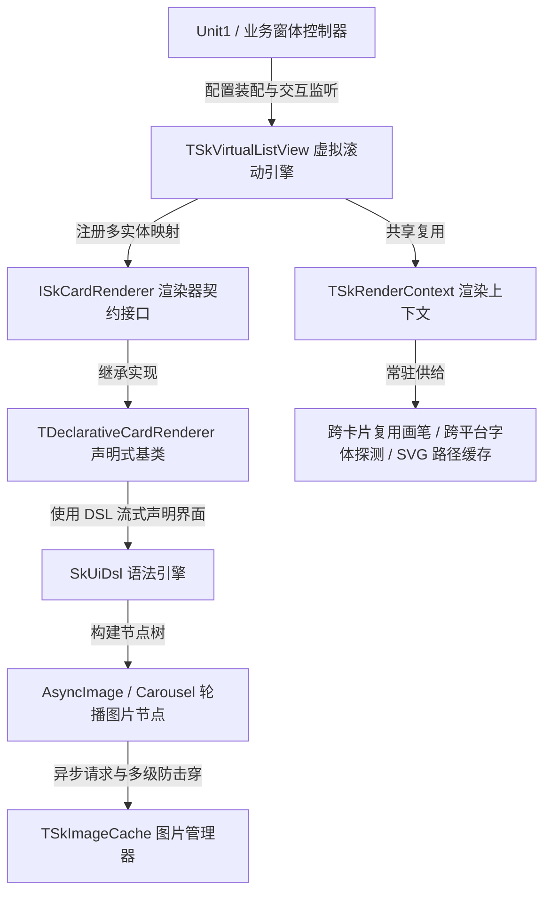
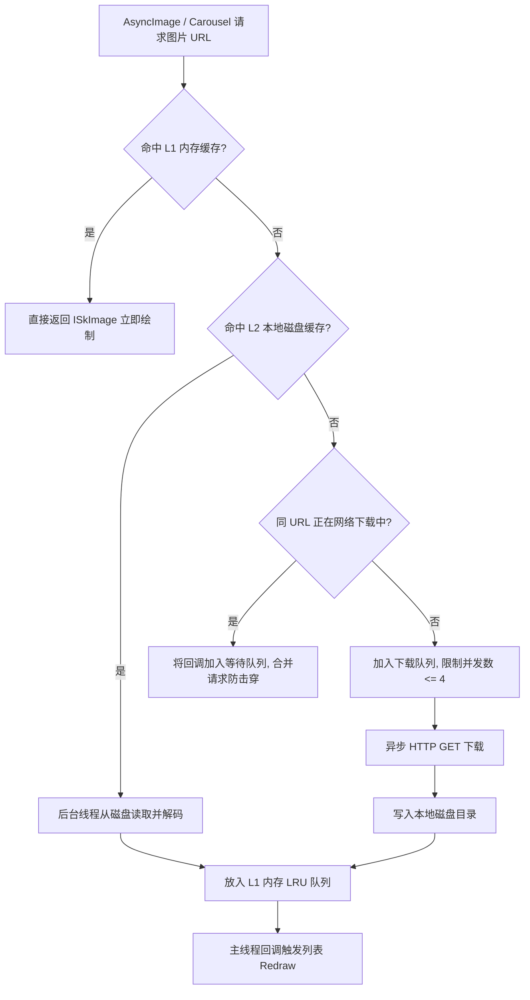
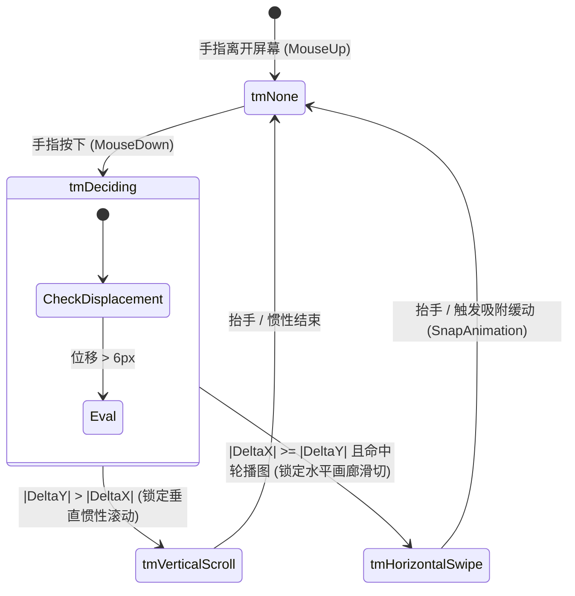

# Delphi FMX + Skia 高性能虚拟化卡片列表与声明式 UI DSL 深度开发手册

## 目录
- [一、 方案概述与技术优势](#一-方案概述与技术优势)
- [二、 架构演进与文件职责清单](#二-架构演进与文件职责清单)
- [三、 快速上手指南 (Quick Start)](#三-快速上手指南-quick-start)
- [四、 核心模块与 API 详解](#四-核心模块与-api-详解)
  - [4.1 通用虚拟滚动引擎：SkVirtualList.Core](#41-通用虚拟滚动引擎skvirtuallistcore)
  - [4.2 声明式 UI DSL 引擎：SkUiDsl](#42-声明式-ui-dsl-引擎skuidsl)
  - [4.3 【核心专题】Flex 弹性伸缩与工业级对齐实战](#43-核心专题flex-弹性伸缩与工业级对齐实战)
  - [4.4 异步多级图片缓存：SkImageCache](#44-异步多级图片缓存skimagecache)
  - [4.5 业务卡片渲染实现：SkCardRenderers.Biz](#45-业务卡片渲染实现skcardrenderersbiz)
- [五、 高阶特性与底层机制深度剖析](#五-高阶特性与底层机制深度剖析)
  - [5.1 单双列同屏异构混排与贪心列高调度 (Heterogeneous Multi-Type Stream)](#51-单双列同屏异构混排与贪心列高调度-heterogeneous-multi-type-stream)
  - [5.2 双轴手势仲裁与平滑画廊巡航 (Touch Arbitration & Carousel)](#52-双轴手势仲裁与平滑画廊巡航-touch-arbitration--carousel)
  - [5.3 原生橡皮筋下拉刷新与智能触底感知 (Pull-to-Refresh & Load-More)](#53-原生橡皮筋下拉刷新与智能触底感知-pull-to-refresh--load-more)
  - [5.4 动态高度多行折行自适应与精准物理度量 (Dynamic Height & Wrap)](#54-动态高度多行折行自适应与精准物理度量-dynamic-height--wrap)
  - [5.5 呼吸流光骨架屏与矢量空状态 (Shimmer & Empty State)](#55-呼吸流光骨架屏与矢量空状态-shimmer--empty-state)
  - [5.6 缓动回顶悬浮按钮与微动画交互 (Smooth Back-to-Top)](#56-缓动回顶悬浮按钮与微动画交互-smooth-back-to-top)
- [六、 实战教学：如何开发一个全新卡片](#六-实战教学如何开发一个全新卡片)
- [七、 进阶特性与生产环境最佳实践 (Best Practices)](#七-进阶特性与生产环境最佳实践-best-practices)
- [八、 常见问题排查与避坑指南 (FAQ)](#八-常见问题排查与避坑指南-faq)

---

## 一、 方案概述与技术优势

在传统的 Delphi FireMonkey (FMX) 移动与桌面开发中，展示成百上千条复杂的电商图文卡片时，通常使用 `TVertScrollBox` 结合大量嵌套的子控件（如 `TRectangle`、`TLabel`、`TImage`）。这种传统方案存在三大致命痛点：
1. **排版遍历风暴**：成百上千个子控件在滚动时频繁递归触发 `Align`、`Padding` 和 `Margins` 布局计算，引发严重的 CPU 瓶颈与滑动掉帧；
2. **内存暴涨与 GC 压力**：每个卡片都对应大量 FMX 控件对象与接口实例，导致堆内存剧烈抖动与显存浪费；
3. **异步加载闪烁与幽灵误触**：异步图片下载容易导致主线程卡顿；拖动滑动时手势识别模糊，用户抬手极易引发子项误点击。

**本项目采用现代移动端渲染引擎（Flutter / Jetpack Compose）的思想，基于 Delphi Skia (Sk4D) 构建了完全自绘、高性能、解耦的虚拟化列表与声明式 DSL 解决方案：**

| 评估维度 | 本方案 (SkVirtualCardList) | 传统 FMX (TVertScrollBox + 控件树) |
| :--- | :--- | :--- |
| **渲染核心** | 单一 `TSkPaintBox` 纯 GPU 画布自绘，单层绘制通道 | 繁重的 FMX 树状子控件多层排版与复合渲染 |
| **虚拟化裁剪** | 数学计算可见视口（Windowing），屏幕外 0 绘制 | 全部节点常驻内存与控件树，性能随条目数线性退化 |
| **内存分配** | 跨卡片共享画笔、字体与 SVG 缓存，**单帧零堆内存分配** | 频繁创建/销毁控件与接口实例，GC 与堆内存抖动剧烈 |
| **UI 编写方式** | **声明式 DSL 流式语法**（HStack, VStack, Box, SkText） | 繁琐的 Object Inspector 属性面板或手动计算 Left/Top |
| **弹性布局** | **全功能 Flexbox 弹性伸缩**（权重分配/弹簧推底） | 僵硬的绝对坐标计算，或带来沉重开销的布局容器 |
| **同屏混排** | **单列全宽大图 + 双列网格瀑布流同屏无缝混排** | 极难实现，需手写复杂嵌套容器并承受双重卡顿 |
| **图片轮播** | **单卡片内支持多图手势滑动切换与视口智能巡航** | 需嵌入复杂的分页控件，滑动掉帧严重 |
| **图片缓存** | **L1 内存 LRU + L2 本地磁盘缓存 + 异步并发限流防击穿** | 需自行管理，若主线程处理易导致界面假死 |
| **手势与触控** | 原生 `TAniCalculations` + **双轴手势仲裁，绝无幽灵误触** | 滑动拖拽与子项 Click 容易冲突，误触发严重 |

---

## 二、 架构演进与文件职责清单

系统遵循高内聚、低耦合的分层微内核架构。业务实体、排版布局、底层滚动引擎与多级缓存完全隔离。



### 文件职责清单

| 单元文件 | 架构层级 | 核心职责与设计要点 |
| :--- | :--- | :--- |
| **[SkVirtualList.Core.pas](file:///d:/develop/borland/yin_tai/doc/202610/SkVirtualCardList/SkVirtualList.Core.pas)** | **虚拟滚动微内核** | 包含通用虚拟列表主控控件 `TSkVirtualListView`、共享渲染上下文 `TSkRenderContext`、渲染契约 `ISkCardRenderer`、多实体异构瀑布流贪心调度、`TAniCalculations` 惯性滚动物理引擎、橡皮筋下拉刷新、触底感知加载更多与平滑回顶微动画。 |
| **[SkUiDsl.pas](file:///d:/develop/borland/yin_tai/doc/202610/SkVirtualCardList/SkUiDsl.pas)** | **声明式 UI DSL** | 提供 `HStack`、`VStack`、`Box`、`Spacer`、`SkText`、`AsyncImage`、`Carousel`、`SkSvg`、`SkCircle`、`SkBadge` 等布局与绘制原语。内置双趟 Flexbox 弹性伸缩算法、二分文本折行探测、以及声明式卡片基类 `TDeclarativeCardRenderer`（带测量树缓存 `TCachedLayout`）。 |
| **[SkImageCache.pas](file:///d:/develop/borland/yin_tai/doc/202610/SkVirtualCardList/SkImageCache.pas)** | **多级图片缓存** | 工业级图片流转引擎：L1 内存 LRU 自动淘汰（上限 80）+ L2 磁盘持久化（MD5 缓存文件）+ 异步并发限流（最大 4 并发）+ 请求去重合并（防击穿）+ `Unsubscribe` 生命周期安全注销。 |
| **[SkCardRenderers.Biz.pas](file:///d:/develop/borland/yin_tai/doc/202610/SkVirtualCardList/SkCardRenderers.Biz.pas)** | **业务卡片渲染实现** | 纯净业务实体（`TProductItem`, `TMerchantItem`）与专属渲染器（单列商品卡 `TSingleProductCardRenderer`、双列网格店铺卡 `TDoubleMerchantCardRenderer`）。实现真实物理动态高度度量自适应与手势画廊扩展协议。 |
| **[Unit1.pas](file:///d:/develop/borland/yin_tai/doc/202610/SkVirtualCardList/Unit1.pas)** | **业务演示与适配层** | 演示虚拟列表在窗体上的挂载、多类型数据装配、单列/双列/同屏混排模式切换、巡航开关控制、骨架屏与空状态演示、Windows 鼠标滚轮穿透转发与子热区精准响应。 |
| **[SkCardListView.pas](file:///d:/develop/borland/yin_tai/doc/202610/SkVirtualCardList/SkCardListView.pas)** | *历史遗留参考* | *初期单一单体（Monolithic）文件原型，已完成全面架构重构成上述解耦微内核体系，工程中已被上述四个核心单元取代。* |

---

## 三、 快速上手指南 (Quick Start)

### 步骤 1：在窗体中挂载虚拟列表与注册渲染器
```pascal
uses
  System.Types, System.Classes, FMX.Forms, FMX.Types,
  SkVirtualList.Core, SkCardRenderers.Biz;

type
  TMyForm = class(TForm)
  private
    FListView: TSkVirtualListView;
    FRendererProduct: ISkCardRenderer;
    FRendererMerchant: ISkCardRenderer;
    procedure HandleItemClick(Sender: TObject; AIndex: Integer; AItem: TObject; AZoneID: Integer);
    procedure HandleRefresh(Sender: TObject);
    procedure HandleLoadMore(Sender: TObject);
  public
    procedure MouseWheel(Shift: TShiftState; WheelDelta: Integer; var Handled: Boolean); override;
  end;

procedure TMyForm.FormCreate(Sender: TObject);
begin
  // 1. 初始化各业务渲染器
  FRendererProduct := TSingleProductCardRenderer.Create;
  FRendererMerchant := TDoubleMerchantCardRenderer.Create;

  // 2. 创建列表并挂载到界面容器
  FListView := TSkVirtualListView.Create(Self);
  FListView.Parent := LayoutContainer;
  FListView.Align := TAlignLayout.Client;
  FListView.ItemSpacing := 8; // 卡片间距 8px

  // 3. 注册实体映射（支持同屏异构混排）
  FListView.RegisterRenderer(TProductItem, FRendererProduct);
  FListView.RegisterRenderer(TMerchantItem, FRendererMerchant);

  // 4. 绑定点击、下拉刷新与上拉触底事件
  FListView.OnItemClick := HandleItemClick;
  FListView.OnRefresh := HandleRefresh;
  FListView.OnLoadMore := HandleLoadMore;
end;
```

### 步骤 2：加载数据并刷新列表
```pascal
procedure TMyForm.LoadData;
var
  Item: TProductItem;
begin
  FListView.Clear; // 清空旧数据与布局缓存

  Item := TProductItem.Create;
  Item.ID := '101';
  Item.Title := '飞天茅台 53度 500ml';
  Item.Price := 1678.9;
  Item.OriginalPrice := 1099.0;
  Item.Images := [
    'https://example.com/img1.jpg',
    'https://example.com/img2.jpg',
    'https://example.com/img3.jpg'
  ];
  Item.ImageUrl := Item.Images[0];
  Item.TagTop := '官方补贴';
  Item.BottomTag := '假一赔十';
  Item.ShopTag := '小店好货';
  Item.PriceTag := '补贴价';
  Item.AutoCruise := True; // 开启多图自动巡航
  FListView.Items.Add(Item);

  FListView.ScrollToTop;
  FListView.UpdateLayout; // 触发测量与排版布局
end;
```

### 步骤 3：处理桌面端鼠标滚轮穿透（Windows 必备）
Delphi FMX 的 `TPaintBox` / `TSkPaintBox` 默认不拦截操作系统派发的 MouseWheel 消息，需在宿主窗体层重写并向虚拟列表转发：
```pascal
procedure TMyForm.MouseWheel(Shift: TShiftState; WheelDelta: Integer; var Handled: Boolean);
begin
  inherited MouseWheel(Shift, WheelDelta, Handled);
  if not Handled and (FListView <> nil) then
    FListView.MouseWheel(Shift, WheelDelta, Handled);
end;
```

### 步骤 4：生命周期安全注销（防止窗体关闭时报错）
在窗体销毁时调用 `TSkImageCache.Unsubscribe(Self)` 取消排队中的异步下载回调：
```pascal
procedure TMyForm.FormDestroy(Sender: TObject);
begin
  TSkImageCache.Unsubscribe(Self);
end;
```

---

## 四、 核心模块与 API 详解

### 4.1 通用虚拟滚动引擎：`SkVirtualList.Core`

#### 1. `TSkVirtualListView` 核心属性与方法清单

| 属性 / 方法 | 类型 | 核心作用与使用规范 |
| :--- | :--- | :--- |
| **`Items`** | `TObjectList<TObject>` | 数据源容器（`OwnsObjects = True`）。列表全权负责数据对象生命周期管理。 |
| **`RegisterRenderer(Class, Renderer)`** | 过程 | 注册数据类型与渲染器的映射关系，支持单/双列同屏无缝异构混排。 |
| **`Renderer`** | `ISkCardRenderer` | 单一类型模式下的默认回退渲染器。 |
| **`ItemSpacing`** | `Single` | 卡片之间的纵向与横向间隙（默认 8px）。 |
| **`UpdateLayout`** | 过程 | **核心排版驱动**：根据当前容器宽度重新计算所有卡片的绝对插槽（`FSlots`）、瀑布流列高并执行视口裁剪。数据增删改后必须调用。 |
| **`Clear`** | 过程 | 清空所有数据对象、重置轮播动画队列并清空各渲染器的 DSL 排版树缓存。 |
| **`OnItemClick`** | `TOnVirtualItemEvent` | 精准点击回调 `(Sender, Index, Item, ZoneID)`，`ZoneID` 区分整卡或子按钮。 |
| **`EnablePullRefresh`** | `Boolean` | 是否启用顶部橡皮筋下拉刷新（默认 `True`）。 |
| **`OnRefresh` / `FinishRefreshing`** | 事件 / 过程 | 下拉超过 50px 松手触发 `OnRefresh`；数据加载完成调用 `FinishRefreshing` 平滑复位。 |
| **`OnLoadMore` / `IsLoadingMore`** | 事件 / `Boolean` | 滚动至距离底部 80px 触发 `OnLoadMore`；加载完成置 `IsLoadingMore := False`。 |
| **`HasMore`** | `Boolean` | 是否还有更多数据（若为 `False` 触底不再触发回调）。 |
| **`IsLoading`** | `Boolean` | 切换骨架屏（Shimmer）模式。置为 `True` 时自动启动微光呼吸正弦动画。 |
| **`EmptyPrompt`** | `string` | 数据为空且非加载态时居中显示的文字提示（默认：“暂无相关数据”）。 |
| **`EnableAutoCruise`** | `Boolean` | 是否允许轮播卡片在静止 3 秒后自动巡航（默认 `True`）。 |
| **`AutoCruiseIntervalMs`** | `Cardinal` | 自动巡航间隔周期（默认 3500ms）。 |
| **`ScrollToTop`** | 过程 | 瞬间滚动回列表最顶端。 |
| **`SmoothScrollToTop`** | 过程 | 260ms 平滑缓动回顶（以 `Cubic-Ease-Out` 三次方曲线驱动）。 |

#### 2. 防误触机制（Anti-Ghost-Click）
用户快速滑动列表手指抬起时，绝不能误触发卡片点击。核心判断逻辑位于触控事件流：
- 记录 `MouseDown` 初始坐标 `FDownPos`；
- 当拖拽位移超过阈值（`CurPos.Distance(FDownPos) > 6px`）时，立即置 `FHasDragged := True` 并取消按下高亮态；
- `MouseUp` 时严格要求 `not FHasDragged`，仅当静止点击时才判定为有效事件，彻底杜绝误触。

#### 3. 共享渲染上下文 `TSkRenderContext`
为避免在每帧 `Draw` 循环中反复创建/销毁 Skia 画笔与字体，`TSkRenderContext` 在初始化时常驻复用核心资源：
- `FillPaint(Color)` / `StrokePaint(Color, Width)`：复用填充与描边画笔；
- `Font(Size, Bold)`：字体对象复用；
- **跨平台中文字体自适应匹配**：内置系统候选字体探测（`Microsoft YaHei`、`PingFang SC`、`Noto Sans CJK SC` 等），跨 Windows/Android/iOS/macOS 均获得无乱码高清渲染；
- `DrawSvgPath(Canvas, SvgPath, DestRect, Color)`：将 SVG Path 解析为 `ISkPath` 并缓存，二次绘制直接使用 GPU 路径。

---

### 4.2 声明式 UI DSL 引擎：`SkUiDsl`

`SkUiDsl` 提供了极其优雅流利的声明式 API，使 Delphi 拥有类似 Flutter / SwiftUI 的编写体验。

#### 1. 容器组件
- **`HStack`（水平排列容器）**：
  - `.Spacing(Single)`：子元素横向间隙；
  - `.Padding(L, T, R, B)` / `.Padding(H, V)` / `.Padding(All)`：外内边距；
  - `.AlignCenter` / `.AlignStart` / `.AlignEnd` / `.AlignStretch`：交叉轴对齐策略；
  - `.Between`：子项两端贴边对齐（`justify-content: space-between`）；
  - `.Children([node1, node2, ...])`：组装子节点数组；
  - `.Flex(Single)`：横向瓜分权重（详见 4.3 节）。
- **`VStack`（垂直排列容器）**：
  - 垂直向下排列子项，支持 `.Spacing`、`.Padding`、`.AlignCenter`、`.AlignStart`、`.AlignEnd`、`.AlignStretch`、`.Flex`。
- **`Box`（样式盒容器）**：
  - `.Fill(Color)`：背景填充色；
  - `.Stroke(Color, Width)`：边框描边；
  - `.Radius(Single)`：全角圆角半径；
  - `.Shadow(Boolean)`：是否开启柔和阴影；
  - `.Padding(...)`：盒模型内边距；
  - `.Size(W, H)` / `.Width(W)` / `.Height(H)`：显式尺寸约束；
  - `.Child(node)` / `.Children([nodes])`：挂载单节点或多节点；
  - `.OnClick(ZoneID)`：定义该盒为独立子热区，点击命中时返回此 `ZoneID`。
- **`Spacer`（弹簧占位符）**：
  - `Spacer.Flex(1)`：自动吞没剩余空间，常用于将操作区或价格栏推至容器尽头；
  - `Spacer(W, H)`：固定空白间隔。

#### 2. 内容组件与高阶属性
- **`SkText(Text)`**：
  - `.Size(Single)` / `.Color(Color)` / `.Bold` / `.Strikethrough`（划线原价）；
  - `.MaxLines(Integer)`：超出最大行数末尾自动绘制省略号（`...`）；
  - `.Wrap(Boolean)`：是否开启多行折行自适应排版。
- **`AsyncImage(Url, Owner)`（异步单图节点）**：
  - `.Size(W, H)` / `.Width(W)` / `.Height(H)`：显式尺寸；
  - `.FillWidth(Boolean)`：横向填满父容器可用宽度；
  - `.Radius(Single)` / `.Radius(TL, TR, BR, BL)`：细粒度圆角；
  - `.RadiusTop(Single)`：快速设置顶部左右圆角（双列封面必备）；
  - `.Placeholder(Color)`：加载未完成时的占位底色；
  - `.Badge(Text, BgColor, RadiusBR, Height)`：快捷角标；
  - `.BadgeRadius(TL, TR, BR, BL)` / `.BadgeFloating(Boolean, Offset)`：悬浮与圆角微调；
  - `.BottomBar(Text, BgColor)`：底部全宽半透明横条；
  - `.OnClick(ZoneID)`：绑定点击热区。
- **`Carousel(Images, Owner)`（多图手势轮播节点）**：
  - `.Size(W, H)` / `.Radius(Single)` / `.FillWidth(Boolean)`；
  - `.ActiveIndex(Integer)`：当前显示第几张大图；
  - `.ScrollOffset(Single)`：手势横滑实时位移；
  - `.AutoCruise(Boolean)`：卡片是否允许自动巡航；
  - `.ShowIndicator(Boolean)`：是否显示底部半透明圆点分页指示器；
  - `.Badge(...)` / `.BottomBar(...)` / `.OnClick(ZoneID)`。
- **`SkSvg(SvgPath)`**：直接绘制 SVG 矢量图标，彻底杜绝跨平台 Emoji 差异。
- **`SkCircle(Radius)`**：自绘几何圆形（支持填充、描边与点击）。
- **`SkBadge(Text)`**：快捷创建彩色背景的文字徽章。

---

### 4.3 【核心专题】Flex 弹性伸缩与工业级对齐实战

`Flex` 是整个声明式 DSL 布局引擎的大脑，源于现代 UI（Flutter `Expanded` / CSS Flexbox）的弹性伸缩哲学。

#### 1. 参数规范与取值范围
- **数据类型**：`Single`（浮点数）；
- **取值范围**：**$\ge 0$ 的非负数**（默认值为 `0`）；
- **核心取值含义**：
  - **`0`（默认值）**：**固定尺寸（非弹性项）**。节点严格按照自身内容（如文本宽度、图片固有大小）计算期望尺寸，不参与瓜分多余空间；
  - **`1`（最常用）**：**独占或均分**。若容器内只有 1 个子项声明了 `Flex(1)`，它将吃掉全部剩余空间；若多个子项同为 `Flex(1)`，则均分剩余空间；
  - **`2, 3, 0.5...`（权重比例）**：按权重数值比例分配容器剩余空间（如 1:2 分割）。

#### 2. 底层排版度量机制（第一性原理数学计算）
在 `THStack.Layout` 与 `TVStack.Layout` 中，引擎通过**严格的两趟加减法**在纯内存中完成单趟布局（耗时 < 0.02ms）：

以包含 1 个左侧固定图片（96px）和 1 个右侧弹性容器（`Flex(1)`）的 `HStack` 为例（总可用宽 360px，间隙 10px）：
1. **第一趟（扣除固定项）**：
   - 累加所有 `Flex = 0` 的固定子项宽度（96px）以及子项间隙（10px）；
   - 计算容器剩余可用空间：
     $$\text{AvailW} = 360\text{px} - 96\text{px} - 10\text{px} = \mathbf{254px}$$
2. **第二趟（分发弹性空间）**：
   - 累加所有弹性项的权重总和：
     $$\text{TotalFlex} = \sum \text{Child.Flex} = 1.0$$
   - 计算单份 Flex 的基准像素：
     $$\text{FlexUnitW} = \frac{\text{AvailW}}{\text{TotalFlex}} = \frac{254}{1.0} = 254\text{px}$$
   - 各弹性子项分得最终宽度：
     $$\text{ChildW} = \text{Child.Flex} \times \text{FlexUnitW} = 1.0 \times 254 = 254\text{px}$$

#### 3. 三大核心实战场景

##### 场景 A：横向占满剩余空间
左侧图片固定为 96px，右侧文字区包裹在 `VStack.Flex(1)` 中。无论卡片在多宽的屏幕上显示，右侧文字区都将自动占满屏幕剩余的所有横向宽度：
```pascal
HStack.Spacing(10).Children([
  ImageNode,                     // 固定宽 96px (Flex = 0)
  VStack.Flex(1).Spacing(4)...   // 自动吃满右侧所有宽度 (Flex = 1)
])
```

##### 场景 B：纵向弹簧推底（底部对齐）
在右侧的 `VStack` 中，放置一个 `Spacer.Flex(1)` 弹簧占位符。它会像压缩弹簧一样，在内存中自动吞噬所有多余的纵向空闲空间，把底部的价格栏和【加入购物车】按钮精准推到卡片最底端：
```pascal
VStack.Flex(1).Spacing(4).Children([
  TitleRow,       // 标题行
  SubtitleText,   // 副标题
  AddressText,    // 地址
  Spacer.Flex(1), // <--- 纵向弹簧！吃掉所有多余高度，把下方推到底部
  BottomPriceRow  // 价格栏与加购按钮
])
```

##### 场景 C：卡片整卡铺满与对齐避坑指南
卡片外框通常带有内边距（如 `Box.Padding(8)`），基准高度为 142px，内部净可用高度为 126px。
- **问题现象**：若外层 `HStack` 未声明 `Flex(1)`，其高度会被算成左侧图片的 114px，导致在 126px 的卡片内部下方空出 12px 悬空缝隙，加购按钮距离卡片底边变成了 $12 + 8 = 20\text{px}$；
- **解决规范**：为根层 `HStack` 显式设置 `.Flex(1)`，并配合 `.AlignStart`：
```pascal
Result := Box.Fill(TAlphaColors.White).Radius(8).Shadow(True).Padding(8).Child(
  HStack.Flex(1).Spacing(10).AlignStart.Children([ // <--- Flex(1) 铺满高度，AlignStart 确保图片顶部对齐
    ImageNode,
    VStack.Flex(1).Spacing(4)...
  ])
);
```
**效果**：无论卡片是普通单行地址（142px），还是超长折行地址（240px），左侧封面图顶边距均严格固定为 8px（与标题平齐），底部加购按钮底边距均严格固定为 8px，实现像素级工业对齐。

---

### 4.4 异步多级图片缓存：`SkImageCache`

`TSkImageCache` 实现了工业级的安全三级图片流转模型：



- **L1 内存 LRU**：内存驻留最多 80 张解码纹理，超出时淘汰最久未使用项，借助 Delphi ARC 释放显存；
- **L2 磁盘持久化**：以 URL 的 MD5 为文件名存入 `SkiaImgCache/`，二次启动零网络流量瞬间秒开；
- **请求去重合并与限流**：并发下载最大限制为 4，相同图片合并为一个网络请求，防止列表狂甩击穿系统网络栈；
- **生命周期安全（`Unsubscribe`）**：窗体关闭时调用 `TSkImageCache.Unsubscribe(Self)` 废弃等待中的回调，杜绝 AV 报错。

---

### 4.5 业务卡片渲染实现：`SkCardRenderers.Biz`

该单元包含具体卡片范例：
1. **单列全宽商品卡（`TSingleProductCardRenderer`）**：
   - 通栏大卡（`SpanCount = 1`），包含多图轮播封面、标签、日期、路段 SVG 图标、自适应折行地址、弹簧推底价格与加购热区；
2. **双列网格店铺卡（`TDoubleMerchantCardRenderer`）**：
   - 双列瀑布流卡（`SpanCount = 2`），顶部 4:3 封面图（`Height(115).RadiusTop(8).FillWidth(True)`），底部展示金牌店铺标签、地址、销量与五角星评分，评分 $\ge 4.7$ 自动拓高展示专属服务横幅（高度由 202 拓高至 226）。

---

## 五、 高阶特性与底层机制深度剖析

### 5.1 单双列同屏异构混排与贪心列高调度 (Heterogeneous Multi-Type Stream)

支持在同一个虚拟列表中同屏混排不同列数、不同高度的数据流（如第 1~4 项为单列全宽大图商品，第 5~10 项为双列店铺网格）：

```pascal
// 注册多实体对应关系
FListView.RegisterRenderer(TProductItem, FRendererProduct);   // SpanCount = 1
FListView.RegisterRenderer(TMerchantItem, FRendererMerchant); // SpanCount = 2
```

#### 瀑布流列高贪心调度算法
在 `TSkVirtualListView.UpdateLayout` 中：
- 维护双列底线数组 `ColBottomY[0]` 与 `ColBottomY[1]`；
- **遇单列项（SpanCount = 1）**：自动拉平两列当前最大 Y 值（`Max(ColBottomY[0], ColBottomY[1])`），全宽放置，并统一向下推进；
- **遇双列项（SpanCount = 2）**：执行贪心算法，自动将卡片填充进当前累计高度较短的一列，两列独立生长。

---

### 5.2 双轴手势仲裁与平滑画廊巡航 (Touch Arbitration & Carousel)

为了彻底解决列表纵向滚动与卡片内部多图横向滑切的手势冲突，列表引入了精密的**触摸状态机（Touch Arbitration State Machine）**：



1. **手势吸附判定**：
   - 当水平拖拽幅度超过图片宽度的 20% 时，判定为成功翻页（向左切下一张，向右切上一张，支持末张循环切回第 1 张）；
   - 幅度不足 20% 则回弹归零；
2. **20ms 定时器驱动 Cubic-Ease-Out**：
   - 动画不在主线程阻塞执行，而是由 `FCruiseTimer`（20ms）逐帧推进 `TSnapAnimation`，以 $1.0 - (1.0 - t)^3$ 曲线平滑过渡，视觉吸附极其丝滑；
3. **智能防打扰巡航**：
   - 用户操作期间立即挂起，停止操作静止满 3 秒后，每隔 3.5 秒自动为视口内声明了 `AutoCruise = True` 的大图卡片触发下一张巡航。

---

### 5.3 原生橡皮筋下拉刷新与智能触底感知 (Pull-to-Refresh & Load-More)

#### 1. 原生橡皮筋下拉刷新
- 列表顶部支持下拉弹性阻尼阻抗；
- **三段式状态提示**：
  - 下拉距离 < 50px：提示“下拉即可刷新...”；
  - 下拉距离 $\ge$ 50px：提示“释放立即刷新”；
  - 松手释放：弹性定格在 -60px 并提示“正在刷新数据...”，同时触发 `OnRefresh` 回调；
  - 数据加载完毕调用 `FListView.FinishRefreshing` 平滑回弹复位。

#### 2. 上拉触底感知加载更多
- 当列表滚动到底部距离内容末端不足 80px 时（`(FScrollY + Height) >= (TotalH - 80)`），自动静默触发 `OnLoadMore` 事件；
- 底部自动展示带有优雅字体的“正在加载更多商品...”提示条，加载完成更新数据即可无缝衔接。

---

### 5.4 动态高度多行折行自适应与精准物理度量 (Dynamic Height & Wrap)

面对电商多变的超长地址，卡片支持单行截断与多行自适应折行：

1. **二分折行探测算法**：
   在 [`SkUiDsl.pas`](file:///d:/develop/borland/yin_tai/doc/202610/SkVirtualCardList/SkUiDsl.pas) 中提供 `SplitTextLines` 函数，利用 `ISkFont.MeasureText` 与二分查找对文字进行断行计算；
2. **真实物理度量（DSL Measure）紧凑撑开**：
   在 `TSingleProductCardRenderer.GetItemHeight` 中直接利用当前平台的真实字体指标调用 DSL 布局树的 `Node.Measure(AContext, AColWidth, 10000)`，得出当前设备下的绝对真实物理高度，并附加 8px 呼吸安全余量（`Max(142, Desired.cy + 8)`），彻底杜绝人工手算误差，确保跨 Windows/Android 平台下【加入购物车】按钮绝不溢出底边；
3. **DSL 声明自适应**：
   在卡片声明中只需为文本添加 `.Wrap(P.MultiLineAddress)`，文字即在可用宽度内自动换行，内部的 `Spacer.Flex(1)` 弹簧自动配合将操作区推至相应底部。

---

### 5.5 呼吸流光骨架屏与矢量空状态 (Shimmer & Empty State)

#### 1. 呼吸微光骨架屏（Shimmer）
当列表设置 `FListView.IsLoading := True` 时，自动进入骨架屏模式：
- 保持卡片阴影白底框架；
- 内部图片块、标题条、副标题条、价格条均呈现正弦波动平滑呼吸动画（亮度在 230 ~ 246 之间正弦振荡）：
  ```pascal
  GrayVal := EnsureRange(Round(236 + 10 * Sin(FShimmerPhase * Pi + R * 0.4)), 0, 255);
  ```
- 双列模式下自动呈现双列店铺专属骨架屏，避免网络慢时界面空白。

#### 2. 矢量自绘空状态
当 `Items.Count = 0` 且未处于加载中时，列表自动居中自绘灰色几何开箱矢量图与 `EmptyPrompt` 提示文案，排版优雅。

---

### 5.6 缓动回顶悬浮按钮与微动画交互 (Smooth Back-to-Top)

- **渐变呈现**：当列表滚动距离 `FScrollY > 180px` 时，右下角自动浮现圆形悬浮按钮（自绘圆形投影底座 + 向上箭头图标）；
- **最高点击优先级**：在 `MouseDown` 第一阶段优先拦截悬浮按钮区域，无需等待手势判定；
- **260ms 平滑回滚**：点击后触发 `SmoothScrollToTop`，以 `Cubic-Ease-Out` 曲线平滑回滚至列表顶端，回滚期间悬浮按钮立即隐藏，绝不残留。

---

## 六、 实战教学：如何开发一个全新卡片

以新增一个**“用户动态评论卡片”**为例：

### 步骤 1：定义实体与子热区常量
```pascal
type
  TCommentItem = class
  public
    AvatarUrl: string;
    UserName: string;
    PostTime: string;
    Content: string;
    LikeCount: Integer;
  end;

const
  ZONE_LIKE_BTN = 101; // 点赞按钮热区 ID
```

### 步骤 2：继承 `TDeclarativeCardRenderer` 编写 DSL 布局
```pascal
type
  TCommentCardRenderer = class(TDeclarativeCardRenderer)
  public
    constructor Create;
    function BuildLayout(AItem: TObject): IUiNode; override;
  end;

constructor TCommentCardRenderer.Create;
begin
  inherited Create(1, 100); // 1 列通栏，基准高度 100px
end;

function TCommentCardRenderer.BuildLayout(AItem: TObject): IUiNode;
var
  C: TCommentItem;
begin
  C := TCommentItem(AItem);

  Result := Box.Fill(TAlphaColors.White).Radius(8).Shadow(True).Padding(12).Child(
    HStack.Flex(1).Spacing(10).AlignCenter.Children([
      // 1. 用户头像（圆形剪裁，44x44）
      AsyncImage(C.AvatarUrl).Size(44, 44).Radius(22),

      // 2. 文本内容区（弹性撑满中间区域）
      VStack.Flex(1).Spacing(4).Children([
        HStack.Between.Children([
          SkText(C.UserName).Bold.Size(13).Color($FF333333),
          SkText(C.PostTime).Size(11).Color($FF999999)
        ]),
        SkText(C.Content).Size(12).Color($FF555555).MaxLines(2)
      ]),

      // 3. 点赞按钮区（独立热区绑定）
      Box.Padding(6, 4).OnClick(ZONE_LIKE_BTN).Child(
        HStack.Spacing(4).AlignCenter.Children([
          SkSvg(SVG_STAR).Size(14, 14).Color($FFFF9800),
          SkText(C.LikeCount.ToString).Size(11).Color($FFFF9800)
        ])
      )
    ])
  );
end;
```

---

## 七、 进阶特性与生产环境最佳实践 (Best Practices)

### 1. 业务数据实体保持无状态（Stateless）
- 严禁在 `TProductItem` 等数据实体中存放 `LastCardRect` 等 UI 绘制坐标或控件实例；
- 测量结果完全由渲染器内部的 `TCachedLayout` 托管，使得同一份业务数据可以随时无缝切换到任意不同形态的渲染器。

### 2. 局部刷新与排版缓存清空
- `TDeclarativeCardRenderer` 会缓存每个 `AItem` 对应的 DSL 测量树。若数据被修改：
  ```pascal
  // 数据更新时清空排版缓存并触发重绘
  (FListView.Renderer as TDeclarativeCardRenderer).ClearCache;
  FListView.Redraw;
  ```

### 3. Delphi 源码编码规范（严禁乱码）
- 所有包含中文字符串、SVG 常量的 `.pas` 源码文件，**必须强制以 UTF-8 with BOM 格式保存**，确保跨平台编译器（DCC32/DCC64/DCCAARM）编译中文常量不乱码。

### 4. 容器组件裁剪（ClipChildren）
- 挂载 `TSkVirtualListView` 的父容器 `TLayout`，建议务必开启 `LayoutContainer.ClipChildren := True;`，防止下拉或回弹时卡片溢出绘制到上方导航栏。

---

## 八、 常见问题排查与避坑指南 (FAQ)

### Q1：在 Windows 下滚动鼠标滚轮，列表没有任何反应？
**解答**：FMX 下非焦点的 `TPaintBox` / `TSkPaintBox` 不会自动接收 Windows 的滚轮消息。必须在宿主窗体的 `MouseWheel` 虚方法中转发给列表（参考 3.3 节）。

### Q2：快速猛烈滑动列表时，手势松开瞬间会不会触发误点击？
**解答**：不会。引擎内部利用 `TAniCalculations` 精确追踪手指位移。只要拖拽位移大于 6px，就会标记 `FHasDragged := True`。在 `MouseUp` 中会自动拦截并丢弃一切点击事件，彻底根除“幽灵误触”。

### Q3：为什么长卡片加高后，图片会垂直居中留下大片空白？
**解答**：因为最外层 `HStack` 默认为垂直居中（`alCenter`）。只需在最外层 `HStack` 加上 `.AlignStart`，左侧封面图就会始终紧贴卡片顶部内边距（固定 8px），与第一行标题对齐。

### Q4：为什么普通短卡片的加购按钮底部留白比长卡片大？
**解答**：因为外层 `HStack` 默认未声明 `Flex(1)`，其高度被算成图片的高度（114px），未填满卡片净可用空间（126px）。只需为外层 `HStack` 添加 `.Flex(1)`，右侧的 `Spacer.Flex(1)` 弹簧即可把加购按钮沉底贴紧卡片内边距底边（固定 8px）。

### Q5：如何注销生命周期防止窗体关闭时报错？
**解答**：在窗体的 `FormDestroy` 事件中调用 `TSkImageCache.Unsubscribe(Self)`，即可取消所有关联到该窗体的未完成下载回调。
